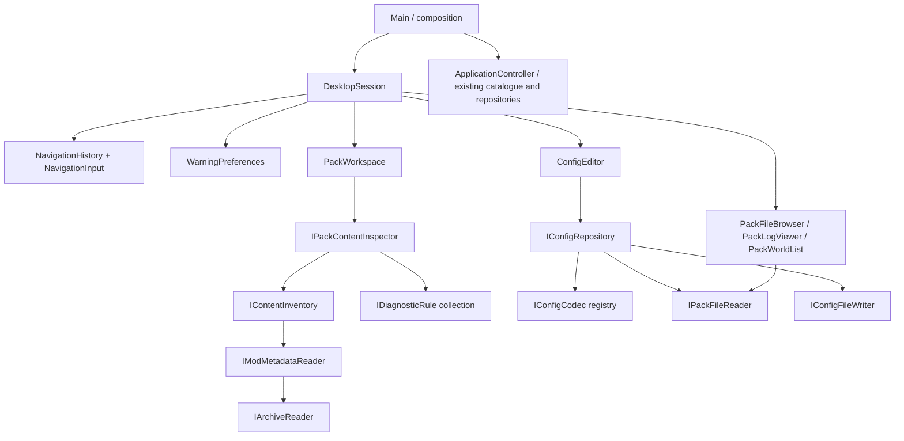

# Foundation architecture

## Ownership and flow

`ApplicationController` retains the catalogue, library and managed-repository application boundary and `CatalogueClient`. Pack content inspection, navigation, preferences and config editing have separate feature models composed by `DesktopSession`; they do not depend on `ApplicationController`. QML pages receive the controller through an explicit required `app` property. Provider HTTP work is asynchronous through `QNetworkAccessManager`. Search and detail generations reject stale responses. Git processes and installation discovery run on QtConcurrent workers. Repository mutations are serialized by the controller's repository-busy state.

`Project` retains provider IDs and source IDs. `mergeProjects` accepts only explicit `provider:id -> shared identity` mappings. If present, load mappings from `project-identities.json` in `QStandardPaths::AppConfigLocation`; example:

```json
{"modrinth:verified-id":"shared-project", "curseforge:12345":"shared-project"}
```

These mappings require review; filenames, slugs, titles and shared source repositories alone do not prove project equivalence. Modrinth wins presentation fields. `mergeReleases` groups exact SHA-1 references only when Minecraft and loader sets match, preserves both provider IDs, and sorts by publication time. Same-label different-file releases remain distinct in the domain. groupReleaseVariants gives the UI one version-label group, retains every variant and puts Modrinth variants first without reversing publication order. isNewerRelease rejects older publication dates, changed project IDs and lower comparable numeric version prefixes.

`decodedImageFingerprint` hashes decoded RGBA pixels and dimensions, handling different lossless image containers. GalleryImages retrieves at most 40 HTTPS images with four concurrent requests, 12-second transfer timeouts, an 8 MiB encoded limit and 4096px dimension limits. It compares decoded pixels and preserves input order, so equal images retain the Modrinth entry. Resized, lossy-recompressed or cropped images remain distinct. Failed image loads are reported without inventing gallery content.

## Local storage

App identity and settings use stable `ModpackStudio` identifiers; the owner-selected display name is Conflux. Managed repositories live below `QStandardPaths::AppLocalDataLocation/packs`. Discovery itself, launcher metadata, world save data and logs remain read-only. Explicit Data Pack installs may add a verified ZIP to the chosen world datapacks directory without changing level.dat. Owner-authorized Content actions can explicitly import/toggle/remove/update JAR/ZIP files through the dedicated content write port; visual-editor Save separately writes identified supported configs. No launcher database or manifest is rewritten by these actions. Modrinth SQLite opens read-only and queries public profile columns only. Current Modrinth instances join their applied content set for game/loader metadata and retain a verified instance ID for launch handoff, with legacy-schema and folder fallbacks. CurseForge folders use `minecraftinstance.json`. Metadata absent from Modrinth profiles is shown as unknown; this does not infer a loader or game version. LibraryRow uses fixed thumbnail, source and action columns around one flexible, elided title/detail column. Both managed packs and launcher installations use the same component. Repeated thumbnails reflect the launcher's actual recorded icon, not a guessed replacement.

`pack.json` schema 1 contains a UUID, display name, Minecraft version, loader, unresolved loader version, and exact mod release references. References retain hashes, provider IDs, compatibility metadata and required dependencies. New optional fields retain structured dependency version constraints, expected file sizes and a managed `installPath`. Existing reference-only packs remain readable. `QSaveFile` writes manifests atomically. Pack creation uses exclusive mkdir and sanitized names, including Windows device-name avoidance. A collision is an error. Git is opt-in and disabled by default: creation/inspection/content operations require no Git executable. Explicit Settings setup validates the author identity and initializes only a managed Conflux pack. A setup failure preserves the usable newly created pack and reports the error.

Git Settings persist an explicit enabled flag and local author identity. Disabling history preserves existing repositories but suppresses status/history work. Git runs through argument arrays with interactive prompts disabled and timeouts. Save stages only `pack.json` and the pack's `.gitignore` and refuses a commit when other files have already been staged outside the app. GitHub authentication, remote operations, credential storage and conflict resolution are intentionally future boundaries.

## Integration boundaries

Modrinth API v2 requests identify the app. CurseForge requests use an in-memory approved key, with no persistent API catalogue cache. Rate-limit and HTTP errors remain visible; a partial merged result reports unavailable providers. This does not resolve CurseForge API licensing/approval questions.

`modrinthRelease` is the shared parser for primary mod JAR files, required/optional/incompatible records and exact version IDs. The legacy foundation ModInstaller resolves required graphs inside managed staging packs, preserving pins and disabled files. The desktop initial-install entry point uses ContentDependencyInstaller instead: selected files commit before independently attempted dependencies. Optional dependencies are not installed automatically; incompatible and embedded records are not installation requests.

Downloads stream into temporary staging with size and SHA-512/SHA-1 verification. Already installed files are checked on a worker and reused. The user can cancel until the short final application step. PackRepository::applyInstallation checks that the manifest has not changed externally, copies verified files with QSaveFile, and saves the new manifest only after copies succeed. Copy/manifest-write failures roll back newly created files. Installed paths are `mods/<sha1>.jar`; binaries remain ignored by Git. Superseded or explicitly removed managed files are deleted only if their bytes still match the tracked hash. Edited or manual files are retained, with warnings when stale edited files need review. Symlink/junction mods folders are rejected for installation and left untouched on removal. This is an application-level transaction, not a guarantee of crash-atomic changes across multiple filesystem files.

Network work is asynchronous; hashing and final file/manifest operations use QtConcurrent. ContentActions serializes file commands while browsing and detail reads continue. Each selected update or initial file uses its own staged transaction. Desktop dependency failures leave already committed selected files installed and are reported separately. Launch/account support remains separate from successful file installation. Existing Modrinth installations use the supported launch-link adapter; approved-key CurseForge file installation is available.

## SOLID feature boundaries

The owner requires rigorous SOLID and clear separation for every addition. Keep policies out of QML, file formats out of presentation models, and filesystem details out of domain workflows. Small files alone are not proof of a single responsibility.



| Build target | Responsibility and permitted dependencies |
| --- | --- |
| `pack_storage` | Read/list and config-write ports plus the native filesystem adapter. Qt Core only. |
| `conflux_content` | Archive/identity/icon adapters, indexed config ownership, inventory and independently injected diagnostic rules. Depends on storage, Qt Gui and miniz; no QML. |
| `conflux_config` | JSON/TOML/properties codecs, parse/validate/read/write repository and headless ConfigEditor state. Depends on storage and QtConcurrent; no QML views or catalogue. |
| `conflux_desktop` | Focused QObject presentation models and DesktopSession composition. Depends on content/config and Qt Concurrent; no provider APIs or repository mutations. |
| `conflux_style` | Shared JSON theme palette. Views consume semantic roles, including SVG icon tint. |
| `pack_foundation` | Existing provider clients, merge domain, launcher discovery, dependency installer and managed Git repository services. |
| `modpack-studio` | Composition entry point and QML view assembly. Wires existing pack context to independent feature models. |

`IPackFileReader` deliberately has no write method. Files, logs and worlds receive that read-only port. Only the config repository receives `IConfigFileWriter`. Formats implement `IConfigCodec`; adding a format changes registry composition, not ConfigEditor or a view. Rules implement `IDiagnosticRule`; the inspector accepts an inventory and rule collection and never switches on rule types. WarningPreferences uses `IWarningPreferenceStore` and filters presentation by category without weakening validation. Archive and metadata readers have replaceable interfaces. Dependencies are constructor-injected and owned explicitly; there are no feature service locators.

`PackPage` composes focused panels under `qml/pack`; only the active panel is instantiated. Settings composes Appearance, Warnings and Connections from `qml/settings`. Shared rounded controls live in `qml/components`. No view writes files or parses TOML/properties/JSON documents. `ConfigField` presents typed values; codec/repository validation remains authoritative. A `DesktopSession` change must only concern wiring, context propagation or lifecycle. It must not acquire format handling, filesystem policy or warning rules.

`ActionButton` owns primary/neutral/subtle action styling, persistent `selected` presentation and input feedback. Selection is supplied by each feature's state; the button does not own routing or filter rules. `NavigationButton` extends it only with sidebar alignment and an active marker; `SectionTabs` composes compact buttons. Search, selects and toggles share the same semantic theme tokens. All palettes retain fourteen tokens across four JSON groups. `Theme` defaults to embedded OLED, retains the original grey palette, copies editable examples without overwriting them, and migrates the old built-in default once using `appearance/oledDefaultApplied`. Subsequent selections and custom themes remain persistent. Presentation changes do not add filesystem, navigation or config policy to views.

## Identity, icons and diagnostics

`ContentInventory` reads known metadata and attaches icon data from bounded archive entries. `ModMetadataReader` understands Fabric/Quilt identity and basic Forge-family TOML identity, and retains universal loader declarations. `ZipArchiveReader` extracts to memory; `rasterIcon` bounds image dimensions and reduces artwork to a small PNG. Resource/shader packs use pack.png when present. Unknown content always has a theme-aware category icon. ConfigAssociation builds a normalized ownership index once per scan; unambiguous filename/directory matches reuse the related mod ID/title/icon. A match is labeled and is not a mod-provided ownership declaration. Ambiguity never silently chooses a mod.

Duplicate IDs, loader/bridge checks, managed pin checks, orphan suggestions and scan coverage are independent rules. Issues have category/message/path fields; the legacy string summary is an adapter for headless callers. Warning visibility is stored separately from the diagnostic result. Scan suggestions never delete configs. Full dependency constraints, nested mod inventories and runtime compatibility remain unfinished.

## Navigation and config editing

NavigationHistory stores page, pack, section, folder, selected log and selected config, with a bounded back/forward stack. NavigationInput only translates mouse Back/Forward presses; toolbar and Alt+Left/Right call the same history. Unsaved edits block navigation and window closing, and produce Save/Discard/Cancel. A failed save retains edits and the pending route. Navigation state is separate from visual selection and supports returning across packs. Worker generations discard stale results for inventory, browsing, logs, worlds and config loads.

ConfigEditor owns a loaded document and draft changes, with typed values available when delegates are recreated after search/filtering. ConfigRepository chooses a codec by extension, validates before writing, and depends on separate read/write ports. JSON preserves numeric values including signed 64-bit integers and serializes the document. TOML uses pinned toml++ parse positions and patches only supported values; comments, CRLF, Unicode keys and unsupported values remain intact. Properties patches supported assignments and preserves unrelated text; duplicate/continued/unsupported assignments are not editable. Collections with internal comment/hash content, complex values and unsafe numeric list precision are omitted rather than silently converted. Explicit TOML range/choice comments become constraints; arbitrary runtime mod schemas are not invented.

NativePackFileStore limits editor documents to 2 MiB, validates config/defaultconfigs paths and rejects linked/escaping paths. Save compares current bytes against the loaded snapshot, writes a unique backup beneath application-local config-backups, rechecks the source, and uses QSaveFile atomic replacement without direct-write fallback. These are optimistic checks, not a filesystem-wide lock against every possible external writer. Backups are outside pack repositories and currently have no automatic retention policy. Unsupported/unknown-owner configs stay inspectable. Editing does not live-reload a running game. Git save still stages the pack manifest/.gitignore; config inclusion is explicitly tracked in BACKLOG.md.

Files browsing is bounded per directory. Logs read plain text tails up to 2 MiB without execution or rich-text interpretation. Worlds list saved-world folders and bounded icons, without parsing or writing level.dat. No automatic config save, world mutation or log upload exists.

## Verification and development

Use `.clang-format` for owned C++ sources; preserve vendored source bytes and licenses. Tests cover actual domain behavior, injected navigation/preferences, config value round trips, lossless TOML/properties edits, conflicts/backups and read-only boundaries. `DesktopSmokeTest` isolates runtime verification from the application entry point. The packaged smoke creates temporary config/log/world fixtures, edits only the temporary config, and captures every section; actual launcher packs are scanned without writes. Always deploy and reopen Conflux after the final verified change. Follow-up work and acceptance criteria belong in [BACKLOG.md](BACKLOG.md).


## Content interactions, updates and filesystem events

ContentActions owns filtering, sorting, selection, frozen-version presentation and asynchronous operation state. It receives IContentFileStore, IContentCatalogue, IContentInstaller and IContentPreferences; it never opens files or performs HTTP itself. NativeContentStore hashes snapshots, restricts writes to immediate content-directory files, rejects linked/escaping paths, backs up originals, rechecks hashes, and rolls back prior file operations if a later step or managed-manifest update fails. These are optimistic checks rather than a lock against every external writer. Folder-based packs are not file mutations.

ContentCatalogue batches Modrinth hash identification, compatible stable update lookup, project metadata and team/author retrieval. No name matching establishes identity. Environment and recognized SPDX license data support filters; unknown data stays unknown. Update comparisons do not turn an older stable release into an automatic downgrade. Versions load on demand. SettingsContentPreferences persists explicit version freezes; file-hash preferences migrate to a verified provider identity without overriding a later explicit unfreeze.

ContentInstaller is the atomic leaf engine. Direct updates and coordinator-owned initial files download into isolated temporary staging, then NativeContentStore.commitStagedContent rechecks the original inventory/hashes, preserves unchanged filenames and disabled state, enforces locks, and applies verified replacements with backups. The legacy aggregate path remains available for explicit staging callers. Known retained mod references use managed hash paths only inside staging, with original filenames preserved for final commit. Unknown local files participate in duplicate-mod checks. Managed imported projects become exact pins. Source metadata changes remain limited to the separately authorized per-content Lock/Unlock adapter.

PackChangeMonitor watches the pack and bounded content paths with QFileSystemWatcher and a 450ms debounce. It invalidates local scans after changes; it does not continuously poll provider APIs. Local metadata appears immediately while async hashes/updates load. Refresh remains available for provider changes and changes not covered by a watcher. Composition serializes mutations with the existing controller busy state. The Views contain only presentation/callback wiring. ContentPanel, ContentFilter, SelectionBox and VersionPicker are separate controls. Warning details open from a badge beside the pack name.

## Native showcases and launch handoff

ProjectShowcase receives an installed-file identity port and a catalogue port. NativeInstalledModIdentity verifies SHA-1 bytes, managed pin hashes, or CurseForge installed-file metadata; the catalogue's hash endpoint identifies Modrinth projects. CatalogueShowcaseSource expands only unambiguous reviewed provider mappings, preserves Modrinth presentation priority and composes bounded gallery deduplication. Native API Markdown/HTML descriptions are converted to selectable Qt rich text with inline images, author colors and non-HTTPS links removed; themed links open through the web boundary; galleries and grouped variants have independent tabs. Stale responses cannot replace a newer route. Public comments are not available through the supported API contracts.

WorldLaunch receives provider adapters, a URL opener and a read-only pack-file reader. ModrinthWorldLaunchAdapter constructs percent-encoded modrinth://launch/instance/{id} links, optionally with singleplayer_world. World launch requires a verified ID, a known supported Minecraft version, a current contained saves directory and readable level.dat. DesktopLaunchUrlOpener uses the registered launcher; Conflux never reads its credentials. A successful handoff reports that the request was sent, not that Minecraft successfully started. CurseForge and independent Conflux launch remain unavailable until a supported runtime/account adapter is implemented. This follows [Modrinth's shortcut implementation](https://github.com/modrinth/code/blob/main/apps/app/src/api/shortcuts/mod.rs).

## Shared provider response reads

ContentDependencyGraph indexes installed provider/version/runtime identities and reverse required/optional edges without I/O. ModMetadataReader retains declared Fabric, Quilt and Forge-family dependency IDs and aliases alongside normal local metadata. ContentViewIndex prepares dependency badges and independent author/tag search fields with each immutable inventory snapshot. DependencyRemovals owns captured-instance cleanup offers and cached row/model state. Its explicit actions enter ContentActions with a dependency-cleanup flag; the queue reads fresh files, source locks and preferences before the executor excludes dependencies still used by other installed content. Shared cycles can be removed together through Remove unused. Shared DependenciesDialog presents both optional installation and dependency removal; removal prompts take presentation priority without dismissing pending optional offers.

ContentMetadataSource retains incomplete enrichment state and diagnostic information, but its completion delivers available rows without a user-facing error for optional metadata failures. Exact missing identity/author data stays retryable. Mutation and verification failures keep their separate action diagnostics.

ContentCatalogue combines compatible candidates from known provider identities. Hash-batched Modrinth checks remain the main path; bounded, coalesced per-project jobs check verified alternate platforms and files whose old release metadata is unavailable. isNewerLinkedRelease compares numbered content versions across platform publication schedules; missing-release fallback requires a current hash identity proof and a strictly newer numbered version. Same-version cross-posts do not create migration updates. Exact CurseForge fingerprint recovery can supply the installed release while Modrinth remains the preferred presentation identity.

JsonResponse handles bounded reply consumption and JSON parsing for CatalogueClient, ContentMetadataSource and ContentCatalogue. Request construction, provider credentials, auth generations, caches and coalescing remain with each client. Large responses parse on workers; reply retirement precedes terminal delivery so a consumer can destroy its owner safely. ContentMetadataSource retains its smaller payload limit and always-worker parsing policy. ContentCatalogue indexes group/hash row positions once and applies each returned candidate only to those installed rows, preserving category, loader, stage and exact project checks.

## Post-write inventory verification

ContentOperationExecutor keeps the write acknowledgment separate from its following inventory read. A successful write permits one bounded read retry on the same worker; the retry never repeats the write. Persistent read failure retains the last source-lock snapshot and acknowledged file projections, with an error barrier in ContentFileState. ContentActions completes the saved action successfully and publishes a separate, non-replayable Reading changes diagnostic. Unverified rows do not enter the persistent metadata index. A later queued command must recover a fresh inventory before its normal hash, lock and policy checks; accepting a new command cannot clear that barrier. Explicit Refresh also recovers through the normal read path.

## Settings and verification additions

SettingsPage uses a fixed-width vertical category index and a separate responsive content pane. Settings and showcase routes participate in the same guarded history. UI pointer dispatch is verified in a test-only executable rather than linking Qt Test into the application. Tests additionally cover stale showcases, exact world-link encoding and path rejection, file backups/conflicts, managed import pins, freeze persistence, selection/filter logic, debounced events and multi-root updates. Packaged verification uses temporary writes and only inspects real launcher installations.

## Description, navigation and config correction

DescriptionRenderer normalizes raw HTML inside Markdown before parsing to avoid a Qt mixed-image/HTML text-loss bug, then parses provider Markdown/HTML and emits a controlled native rich-text subset. It preserves text, headings, emphasis and HTTPS links without serializing provider font colors, frame/table CSS, inline images or empty image-only blocks. This prevents inherited black text and empty web layouts on OLED. The QML theme supplies foreground/link colors.

NavigationHistory replaces the current route for section, folder, log, config or Settings/showcase-tab changes within the same page identity. Page identity includes the pack and, for showcases, the installed file or catalogue project. Back/Forward traverses pages and restores each page's most recent local selection. The same unsaved-config guard applies to replacements.

Forge-family identity uses the existing pinned toml++ parser and reads only the actual mods array declaration, never a dependency's modId. Genuine duplicate issues group all enabled file paths under one ID.

ConfigLibrary owns config availability/presentation and explicit owner associations through IConfigOwnershipStore; SettingsConfigOwnershipStore persists local per-pack/per-file choices. It derives supported extensions from the codec registry. Missing/stale associations cannot enable editing. DesktopSession composes this model and resolves editor targets from it after workspace scans. The view defaults to editable files; Needs review exposes Identify mod and format limitations. Existing codec-backed forms, backup/conflict checks and explicit Save remain authoritative.

Catalogue invokes registered Java IConfigScreenFactory screens; Configured obtains loaded ModConfigSpec values, defaults, validation and restart metadata at runtime. These are not executable from a C++ launcher without a game-side bridge. Conflux supplies offline typed controls from supported file values and explicit TOML metadata, and does not invent missing defaults/enums/runtime constraints. Research: [Catalogue](https://github.com/MrCrayfish/Catalogue/blob/c556f997d5539c77fb3371eeccf755ca8a00f321/neoforge/src/main/java/com/mrcrayfish/catalogue/client/NeoForgeModData.java), [Configured](https://github.com/MrCrayfish/Configured/blob/9f78baf593ca1d90ffec7c2d9d8a4a2d027d15e4/neoforge/src/main/java/com/mrcrayfish/configured/impl/neoforge/NeoForgeConfigProvider.java).

UI glyphs use the Lucide SVG subset pinned at c29c276f16590cf017126671535ad8c792be64d8; third_party/LICENSE.lucide retains its license. Shared ContentIcon crops artwork to fill its rounded clip. Artwork stays separate from UI glyphs.

## Instance-scoped Explore content

BrowseInstalls receives IContentCatalogue and consumes indexed content supplied by DesktopSession. Exact requested/context path matching and lookup generations prevent stale installs. Installed state uses provider IDs/hashes; disabled files remain installed. Data Packs are instance-scoped, including compatible mod-form variants. World selection is no longer part of browsing or installation.

BrowseCatalogue owns typed query filters, provider cursors, deduplication, cached pages and per-instance/content-type scroll state behind ICatalogueSearch and IContentVisibility. It merges sorted provider streams in bounded batches, preserves provider rank when relevance scores cannot be compared, hydrates reviewed CurseForge identities from Modrinth before publishing, and retains distinct download counts. Next/Previous use generated pages without refetching when returning from showcases. Each generated page is bounded to 24 source reads; heavily hidden result sets can yield a partial page with an explicit notice. Provider/API failures are visible. CatalogueClient translates typed multi-version/loader/tag groups into native provider requests and fetches version/category taxonomy. Provider-scoped tags never imply guessed cross-platform category equivalence. Followers have no native CurseForge equivalent; that source uses popularity with a visible notice.

ContentVisibility stores explicit project IDs, exact hashes and per-instance fallback paths through IBrowseSettingsStore; hiding changes presentation, never enabled state or installed files. BrowsePreferences independently owns the persisted Connector search option. ReviewedProjectIdentities is the bounded file adapter for reviewed source mappings, shared by browsing and showcases; ambiguous groups are rejected.

ContentInstaller dispatches mods to the dependency transaction and ZIP assets to AssetInstaller. Size/hashes/ZIP structure, staging, backups, collisions and optimistic manifest checks remain. Managed ZIP references are recorded in assets and download directories stay Git-ignored. ZIP packs with required dependencies remain visibly blocked until cross-type planning is available.

Data Pack ZIPs install into instance datapacks/, never saves. ZIP-only data packs require a global data-pack loading mod to apply across worlds; no world/NBT rewriting or running-world synchronization is claimed. Compatible native JAR variants are preferred and use the existing mod/dependency installer. Enabled verified Connector metadata admits Fabric alongside Forge/NeoForge through ContentCompatibility; bridge transactions always use isolated staging and recheck the original inventory before application. Primary loader metadata stays unchanged, and runtime compatibility is not inferred from bridge presence.

## Shared branding and rounded presentation

ContentTypes supplies display labels while canonical loader/type IDs remain lower case. Branding is a Conflux.Style singleton backed by themes/brands.json; BrandBadge shares loader/provider imagery, identity colors and rounded geometry. NeoForge's fillIcon presentation uses the official 128px fox artwork clipped to a circle at the full badge height, without a second padded container for icon-only badges; labeled filters reuse the same filled mark. Official Fabric/NeoForged artwork and Simple Icons provider glyphs retain attribution/license notices. Forge/Quilt use Lucide compatibility symbols. Identity colors do not add feature-specific theme color tokens.

ProjectCard presents artwork, title/author, summary, category/loader badges, Install/Installed state and independent provider statistics. It contains presentation callbacks only. ContentIcon supports cropped squares and fitted gallery images with rounded Canvas clipping on software and normal Qt rendering; author avatars use the same component. Shared controls/menus remain rounded.

CompatibilityBadges is the shared version/loader pair: neutral Minecraft-version pill directly beside the branded loader pill. Library separates this intrinsic-width group from the flexible mod count. Pack headers, browse filters/cards and release rows reuse it. List/Grid views set StopAtBounds; BoundedScrollView applies the same policy to Qt Quick Controls' auto-created Flickable so settings, descriptions, logs and menus cannot rebound past their content.

BrowseFilterPreferences implements IBrowseFilterPreferences over IBrowseSettingsStore. It persists only version/loader choices, version-lock state and whether loaders still follow instance/Connector defaults, partitioned by hashed instance identity and content type. BrowseCatalogue retains provider cursors and pages in memory independently for each such view. Restoring a view while instance metadata is pending must not erase its compatibility or page. Version relocking affects versions only; loaders remain editable. Saved manual loader selections override later Connector-default changes. PaginationBar groups source selection with page controls and wraps its two control groups at narrow widths; the instance selector aligns with the fixed-width filter panel.

The shell top bar owns route titles and the Explore instance selector; DiscoverPage owns the content toolbar/results and filters, with no duplicate title/context block. New-pack creation remains in the sidebar and Ctrl+N. BrowseFilters uses a virtualized, bounded multi-select list for all API-provided game versions when unlocked. RoundedToolTip centralizes tooltip background/text/theme and replaces all attached default tooltips.

### Appearance authoring and layout preferences

Theme is a palette/selection/draft model; ThemePalette owns the four-group/fourteen-role schema and JSON codec. IThemeStore isolates file/selection persistence, with NativeThemeStore handling bounded contained reads, safe generated custom filenames, QSaveFile writes and the existing OLED migration. Color drafts preview immediately across the UI; Save theme writes a custom JSON without modifying presets. Invalid colors/files keep the last valid palette; discard restores the loaded palette.

Appearance owns validated size descriptors and values behind IAppearanceStore; NativeAppearanceStore persists them separately from theme documents. Overall UI scale transforms the logical shell viewport and popup overlay together. Compact sidebar layout and constrained filter widths protect small viewports. Content scale, artwork size/insets/gaps, filter scale/width/section spacing and version-list height are independent preferences. AppearanceSettings pins an AppearancePreview above its scrollable controls; that preview reuses ProjectCard and BrowseFilters with explicitly labeled example data, without network/file actions. Smoke runs isolate both style models under their temporary storage directory.

ProjectCard uses a compact single-line summary, equal artwork insets, right-side actions and a bottom-aligned bounded horizontal badge row. All metadata remains available by horizontal scrolling when it cannot fit. Badge order is provider icons, the intersection of supported/selected loaders (empty filter means all), Minecraft version, environment/category tags. Native installed-content tables also keep menus at the far right. Loader/provider brand colors remain centralized identity metadata; the fourteen UI roles cover configurable theme colors. Built-in palettes use candy-red #FF005E accent.

ReleaseFilters is a pure showcase selection model: OR within channel/game-version/loader choices, AND across groups and source. Mod showcases fetch all releases; defaults select actual instance compatibility, independently of installation validation. Group filtering preserves exact variant maps/hashes and Modrinth ordering. Shared ChoiceFilter bounds searchable multi-selection; PopupButton uses modal outside-press dismissal so a second click closes without reopening. ActiveBrowseFilters summarizes discovery choices; only instance-controlled game versions display a lock. Static scan/compatibility paragraphs are omitted from browsing surfaces while failures and actionable diagnostics stay visible.

FocusPopup and FocusDialog centralize modal input blocking, keyboard focus and overlay stacking for all in-app menus, selectors, warnings and dialogs; native file/color dialogs retain native focus. Content tables omit an outer stroke. Contiguous row hover/selection backgrounds fill each rectangular cell; a single outer table corner mask rounds the complete frame, including partially visible rows. The table disables nested viewport corner masks and omits the final row divider. ActionButton gates hover, pressed and keyboard-focus effects on enabled state, including a button that becomes unavailable under the pointer.


### Native source content and gallery viewing

DescriptionRenderer parses provider markup into RenderedDescription: readable HTML plus typed text, image-row and table-cell blocks. Raw HTML fragments in Modrinth Markdown are converted before parsing to avoid Qt dropping text after banner blocks. A small HTML/URL boundary removes scripts, provider colors, event attributes and non-HTTPS media, preserving text structure and source image links. Text blocks inherit the theme; DescriptionView lays out responsive rounded images, selectable text, code, quotes and table cells. The parser owns markup conversion; QML only presents blocks and emits link/image intents. Arbitrary browser CSS, embeds and scripts are not executed. Source document input is limited to 2 MiB and frame traversal to twelve levels.

GalleryView renders verified source images and emits selected indices. GalleryViewer owns only transient image selection, fit-relative zoom and pan; it uses the shared focused modal policy, keyboard arrows/Escape, previous/next, zoom/reset, original-link and Close controls. Native file/provider/installation state is unaffected.

ContentListView and ContentGridView reserve a separate sixteen-pixel scrollbar lane. ContentScrollBar supplies rounded consistent thumbs; ScrollViewportCorners covers viewport corners on both software and native rendering, including partially scrolled hover backgrounds. BoundedScrollView reserves the same lane for forms/descriptions. ProjectCard uses one filled rounded surface, explicit author/title baselines, one combined downloads icon, optional known follower counts and an icon-led relative update date. Installed opacity is a validated persistent Appearance value (25-100%, default50); uninstalled cards remain at full opacity independently of install readiness. The previous unavailableOpacity setting migrates to installedOpacity when no new key is present. The live preview includes an installed example. Card labels and tags retain accessible names without tooltips; right-side statistics expose precise tooltips.

ActionButton hover/down/disabled/focus states change paint only, never size, padding, font metrics or corner geometry. Icon-only actions are circular; FilterChip contains its circular trailing remove action with an inset and paints keyboard focus on the enclosing pill. SearchField owns a contained trailing clear action that emits the same textEdited intent as typing and returns focus to the field. ContentPanel separates filters from a padded/divided action group, orders Hidden/Updates/Update all and anchors Refresh at the far right; groups wrap at narrow widths without forcing the table out of bounds.

ProjectCard aligns installation, statistics and update age to one trailing column, reserving a separate far-right menu rail. ContentStatistic owns consistent sixteen-pixel provider/semantic icons, numeric text and vertical centering; provider counts remain separate.

### Tabbed settings and presentation preferences

Settings keeps the vertical category index with compact icon navigation on small logical viewports, omitting a duplicate page heading. AppearanceSettings owns Interface/Content/Filters/Colors sub-tabs, current-section search, preview visibility and bounded control scrolling. AppearanceField renders validated numeric, toggle and choice descriptors; per-field and per-section reset leave other groups and theme drafts intact. ThemeSettings separates theme selection/draft saving from layout preferences and divides all fourteen existing roles into Surfaces/Text/Actions/Status tabs. Preview uses real shared rows/cards/filter components with labeled example data.

Appearance persists twenty-nine presentation values through IAppearanceStore: the existing sizes/opacity plus library/instance row height, scrollbar width, tooltip delay/visibility, persistent live-preview visibility, navigation mode, reduced motion and seven card-metadata toggles. RoundedToolTip owns the shared visibility gate; callers request showWhen rather than overriding visible. Existing button/field/library/switch transitions honor reduced motion. Instance rows retain one rounded outer table frame.

BrowsePreferences validates and persists default sort/page size/provider/installed visibility through IBrowseSettingsStore, separately from Connector selection and per-instance/type compatibility. BrowseCatalogue.setDefaults seeds previously unseen views; visited snapshots and saved version/loader filters take priority. DesktopSession only composes the model updates. Browsing Defaults offers an explicit Apply to current view action; changing defaults alone does not reset the user's active query/page. Invalid persisted defaults fall back without writes during load.

GalleryViewer uses a full-screen backdrop mouse area that accepts only clicks outside both the visible image viewport and toolbar, rejecting presses over either surface so control clicks and drag-to-pan reach their existing handlers. Its100% zoom baseline is galleryFitPercent (60-100%, default83) of the available fit area; zoom controls remain relative to that baseline.

ProjectCard hover uses an ancestor HoverHandler independently of its click MouseArea. Child badge/statistic/button hover cannot clear the filled card highlight.

BrowseCatalogue sends loader constraints only for mod discovery; other content types retain their saved state without applying or displaying those constraints. ProjectCard retains non-mod loader/data-pack metadata independently of hidden loader selections. CatalogueShowcaseSource explicitly requests allVersions from CatalogueClient for complete release filter choices; installer callers retain constrained requests by default. ReleaseFilters includes datapack as a platform alongside real loaders, preserves exact variants, and combines platform choices with OR. ChoiceFilter provides a selected-value/count trigger, separate inline Clear, searchable bounded list, selected count/Clear header and trailing checkmarks.

ContentCatalogue separates stable update queries by destination and platform: mods preserve their installed loader edition within actual compatible loaders, resource packs minecraft, data packs datapack and shaders their identified loader set. Hash plus category keys prevent cross-format collisions. Only newer exact-project stable releases with the same archive kind, game version and permitted loader become update candidates; every check resets stale flags. See [Modrinth bulk update API](https://docs.modrinth.com/api/operations/getlatestversionsfromhashes/).


ContentSelectionBar is an anchored sibling overlay: selecting does not change table/list geometry. Its compact form uses icons and its Share popup copies locally through copyRequested (no remote posting). ContentActivity reserves fixed toolbar space for operation status/cancel, opens focused error details and omits routine success/cancellation paragraphs. ContentActions.notice is reserved for actionable problems while activity/activityText carry transient operation presentation.

ContentLink shares underline-only pointer/keyboard behavior without altering metrics. Instance and discovery names open Description, version labels open Versions, and author links open a dedicated discovery context using exact provider author identifiers. The author context starts with All content and unrestricted compatibility, retains its own pages/scroll/type and preserves the instance install destination. Author navigation is a distinct history entry; tab changes remain within the page. Modrinth authored projects use [user projects](https://docs.modrinth.com/api/operations/getuserprojects/) then the existing typed/paged search. CurseForge uses [authorId filtering](https://docs.curseforge.com/rest-api/#search-mods), behind the approved-key gate. Project results still merge only through reviewed project identities. ReviewedAuthorIdentities reads bounded author-identities.json provider:id -> shared group mappings from AppConfigLocation, rejects ambiguous/conflicting mappings and never matches display names. Missing cross-platform identity mappings do not authorize querying unrelated creators; live CurseForge use still needs an approved key.

Automatic mod update queries intersect instance-compatible loaders with the installed release’s actual loaders, preferring the instance primary loader when that installed edition supports it. Connector does not turn a later Fabric upload into an update for an installed NeoForge build. An installed Fabric mod still updates within Fabric while using Connector. Manual version browsing retains the broader compatible loader choices. isNewerRelease rejects identical SHA-1/SHA-512 binaries even if a provider republishes them with a different release ID and later date; distinct newer rebuilds with the same version label remain eligible.

ShowcasePage derives Gallery tab availability from validated gallery images; Description and Versions retain stable stack indices, and stale empty Gallery selections fall back to Description. SmoothScroll centralizes vertical wheel behavior for SmoothListView, ContentListView/GridView and BoundedScrollView. Discrete wheel deltas accumulate bounded destinations and animate with OutCubic easing; pixel-delta input applies directly so trackpad gestures retain their precision. Pointer dragging, scrollbar interaction, focus/modal changes and hidden views stop queued motion. ContentListView exposes wheel motion/settling through its existing moving/movementEnded contract so history restoration keeps the final offset. Appearance Interface adds scrollDistance40..400(default140px/notch), scrollDuration80..400(default180ms) and smoothScrolling(defaulton); reduceMotion also disables animation. [Qt WheelHandler](https://doc.qt.io/qt-6/qml-qtquick-wheelhandler.html) and [WheelEvent](https://doc.qt.io/qt-6/qml-qtquick-wheelevent.html) define the input units. Strict StopAtBounds, external gutters and enlarged-gallery plain wheel navigation and Ctrl-wheel zoom use their separate viewer handler.

Inventory refreshes retain the current workspace result until replacement data arrives. PackWorkspace serializes inspections and coalesces requests during a scan into one follow-up for the latest pack/generation; stale results are never published. DesktopSession starts content hashing once from each completed workspace inspection, including when inventory metadata is unchanged, so same-size external edits remain detectable. ContentActions reuses provider metadata by exact category/SHA-1 and merges indexed rows by exact relative path/SHA-1 using hash lookups; full file hashing and write-time optimistic checks remain authoritative. PackChangeMonitor updates only added/removed watch paths and re-adds watches dropped by native file replacement.

Main uses shared WindowControls, WindowDragArea and WindowResizeEdges. Windows keeps a standard resizable window style and native placement ownership; WindowFrame removes its caption through WM_NCCALCSIZE, retains native resize hit testing and insets the proposed maximized rectangle by the DPI-specific resize borders. It does not replace that rectangle with monitor coordinates or combine Qt frameless geometry emulation with native maximization. Native move/resize APIs retain Snap, drag-to-restore and operating-system work-area bounds, with compositor rounded corners. Other platforms retain the frameless fallback. The minimum window height is 480 logical pixels. Native integration is skipped on offscreen/non-Windows platforms. The existing close/unsaved guard receives custom Close. Discover instance selection sits above its filter column at identical width, leaving title-bar controls at the far right. BrandBadge uses explicit centered artwork bounds; ActionButton centers icon-only content even when its navigation variant requests left-aligned text.

ContentActions owns command intent and projects pending operations over confirmed per-instance ContentFileState. ContentOperationQueue serializes accepted writes, while ContentOperationExecutor owns asynchronous port execution, exception conversion and post-write verification. ContentOperationState owns pure stable-key reconciliation/projection; ContentListModel changes individual modelData roles and inserts/moves/removes rows without model resets. Progress and selection changes do not rebuild delegates. Successful toggles/removals reconcile their known path changes without rescanning archives; installs/imports and failures reload authoritative inventory off-thread. Later jobs resolve against confirmed rows, preserving hash checks through rapid opposite toggles and replacements. Each operation retains its destination across navigation. One compatible-version lookup queue responds optimistically per project without globally disabling discovery.

SettingsContentPreferences persists independent locks and successful existing-content version-change timestamps per instance/verified identity, with contained-path lock fallback. ContentLockRegistry provides short thread-safe path-policy reads to NativeContentStore; write preflight and immediate commit checks protect locked replacements and dependencies, including source locks changed outside Conflux during staging; Conflux rejects lock changes while instance operations are pending. Unlocking is explicit. Existing version freeze remains separate and only limits version changes. Update counts include protected content; actionableUpdateCount excludes locked/frozen/pending entries. Recent filtering uses Conflux-completed version changes in the last seven days. Nonmodal global error toasts replace loading/cancellation chatter; background operations never open progress popups or shift lists. Closing cancels uncommitted version lookups and lets already accepted file transactions drain with the window hidden. Queues are in-memory, not crash-persistent jobs. Existing per-file backups/optimistic external-change checks remain authoritative.

Read-only post-write ApplicationController.refreshActivePack runs without repositoryBusy/navigationBusy transitions. A generation guard rejects results after later content work, repository changes or instance navigation; activeRefreshPending is a verification accessor, not a presentation busy state. DesktopSession switches ContentActions to the new instance immediately, restoring confirmed cached rows or an empty list while inspection runs. PackWorkspace keeps its published files on same-path metadata changes and clears only for a different root.

Discovery exposes BrowseCatalogue.pageCount/goToPage for editable active-page fields and first/nearby/last shortcuts. A single provider without client-side hiding can jump by native offset; merged/hidden views asynchronously materialize intervening pages to preserve unique identities and filtering. Sparse cached pages remain reachable and per-context snapshots retain the current page/scroll. Provider totals give a page-count upper bound for merged or client-filtered results; exhaustion resolves the final page.

Project.totalDownloads sums nonnegative, verified per-platform counts once; Project.toVariant exposes downloadsRaw, the compact combined downloads label and exact downloadStats breakdown. Modrinth remains the preferred presentation source. Download ranking hydrates reviewed counterpart IDs through available provider access, sorts combined counts and reads ahead when unseen provider results could outrank the next card. Cached metadata preserves each provider count through repeated identity merges. No provider credentials are invented; unavailable provider counts are excluded. ProjectCard uses one neutral download icon with a total and platform breakdown tooltip, exact followers and localized update timestamps. Other card labels/tags keep their quiet hover behavior; shared tooltips use rounded selection-colored surfaces.

## Atomic content commands and status HUD

ContentActions reserves normalized paths and verified provider identities when accepting a command. A second operation on the same content is rejected visibly; unrelated commands queue without resetting the list. Optimistic projections retain one stable row even when an update changes the filename. Lock changes are rejected while an instance has pending operations. Missing files are excluded from snapshots.

ContentInstaller prepares each accepted transaction in an isolated workspace before applying any destination changes. Initial installs can include their required dependency graph in that transaction. Bulk updates enqueue one transaction per eligible content item, so successful items remain committed if another item fails or is cancelled. NativeContentStore rechecks the original inventory, hashes, install-time dependency policy, local locks and read-only Modrinth launcher locks before committing. ContentAccess serializes snapshots and file changes through a canonical per-instance recursive worker gate and cross-process QLockFile; readers observe complete transactions. QSaveFile stages complete replacement files, backups support rollback of earlier edits, and failed rollback is reported as changed and cannot be blindly retried. These guarantees cover cooperating Conflux processes and handled failures. External launchers do not honor this lease; hash checks detect observed external changes. A crash-durable multi-file journal is not implemented.

LauncherContentState reads only public file, identity and lock fields through read-only SQLite. Launcher databases/manifests remain untouched. A missing launcher-locked file can be repaired only with its exact pinned hash from a verified Conflux backup; a different release remains blocked. Local project locks can be released from discovery when their file is absent.

OperationHistory is a stable list model with queued/running/completed/failed states, bounded session history, copy details, safe retry, cancellation before commit and dismissal. Failed operations stay visible in the title-bar task HUD. RunningInstances polls asynchronously, matching known instance paths to Java --gameDir through an injected process source. Only PID and directory leave the hidden Windows helper; command lines and access tokens are not retained. Failed probes preserve the last known state and show unavailable status. File/inventory exceptions retain the previous UI snapshot and produce an error notification. Config/Git operations keep their own existing transaction contracts; this HUD tracks content commands.


## Direct updates, literal search and changelogs

ContentInstallRequest.resolveDependencies defaults true for initial installs and becomes false for existing-content replacements, Update/Update all and version switches. ModInstaller retains unrelated pins without provider resolution, dependency traversal or repeated download prechecks. Selected update roots still require the instance Minecraft version in their supported-version set and a permitted installed loader; multi-version/multi-loader arrays are set membership, not exact-list equality. ContentInstaller prevents switching a primary-loader edition to a Connector-assisted Fabric edition during updates. Hash/size/archive verification, locks, inventory checks, backups and atomic application remain mandatory. Only initial installs traverse required dependencies; updates do not change dependencies unless those dependencies are explicitly selected too.

ContentActions.queueUpdates snapshots eligible intent for Update all/selected, skips protected and pending rows, and publishes one optimistic projection after enrolling the individual commands. Each queued item retains its original selected hash and stable key; the executor rejects missing, changed, newly locked or newly frozen targets independently. Every completion reloads confirmed state before the next item starts. A failed verification read is retried on a worker before another write is permitted; it cannot authorize an unchecked write or an unsafe retry of a possibly committed item. Failed commands are retryable only when no changes were reported. Source lock IDs are indexed once per preference pass, every verified provider lock is honored, projection uses stable-key indices, and recent-update timestamps use an indexed comparison. The queue drains before one coalesced content refresh. Initial multi-root installation transactions keep their existing dependency semantics.

ContentUpdates.cpp contains bulk-update eligibility, per-item enrollment and release-selection commands. Metadata reconciliation prefers the exact unchanged path/hash pair, then a unique category/hash match; identical files at different paths do not inherit each other's platform identities. PackRepository.inspectContent retains manifest and Git-ownership checks without spawning Git status/history queries; transactional reads/writes use it while ordinary inspect still retrieves repository presentation data. OperationHistory publishes terminal state/message/retryability together and retains at most100 inactive tasks in addition to all active tasks. Retiring old tasks also releases their failed-command retry payloads.

ContentInstaller annotates retained staging references with confluxRetainedPath. NativeContentStore.commitStagedContent validates each original path/category/hash and preserves that input without project rematching or replacement. This keeps unrelated locked files and pre-existing multi-file project identities outside the selected update's edits. Missing, changed, duplicate or simultaneously replaced retained origins fail before writes. The staging-only field is removed before publishing a managed manifest. Selected replacements still pass current source/Conflux locks, identity, inventory, backup and atomic-write checks.

OperationHistory orders running tasks first, queued work in execution order next, and terminal history last. Model row moves preserve task identities and delegate state. The overview opens at the top. Clear finished removes terminal successes/failures and their retry payloads in one model removal; active and queued work remains.

TextQuery folds case/accents and ignores separators, with literal matching only. Its ranks are whole normalized value, whole word, word/title prefix and other substring; local option filtering partitions these four ranks in linear time. Compact numeric version inputs still match dotted versions. There is no typo, omitted-letter or subsequence matching and no broader provider retry. DesktopSession composes CatalogueClient directly. BrowseCatalogue prepares the current query once, accepts literal title or metadata matches, and prioritizes title ranks over metadata under Relevance within each fetched candidate page and across provider heads. Other explicit sorts retain their order. Native consumed offsets count every provider row before local filtering; queried page jumps therefore retain the sequential filtered cursor. Candidate reads keep the existing24-page bound, cached views restore their query, and unseen native pages are not claimed to have been globally re-ranked.

ProjectShowcase delegates changelog history to VersionChangelogs. This presentation-only model groups declared Minecraft/loader variants by content version, preserving prerelease qualifiers and exact provider/release aliases. It prefers Modrinth text within the verified project. Exact release pins and the Versions list stay unchanged. Modrinth logs come from version responses; CurseForge logs load lazily through its authenticated changelog endpoint. ChangelogView has Latest and All versions subtabs; All versions is a virtualized continuous list with horizontal separators. Entries load on demand with at most two concurrent loads, worker formatting, per-version errors/retry and cached parsed blocks until project close. Generation guards discard stale callbacks. Version-name links reveal the matching content-version entry. Description formatting also runs on a worker. No logs are inserted into pack.json.

ControlStyle defines four semantic corner families: main tabs22, subtabs18, buttons/fields/disclosures10 and panels14; pills/circles retain their intrinsic geometry. Shared actions and selector options have state-aware outlines and bounded, elided labels. NotificationBanner lays out wrapped text and its outlined dismiss action inside padding. RoundedToolTip measures intrinsic text before applying a viewport-width cap, keeping short statistics on one line; update hints omit seconds and weekday names. Sort selectors use the option name alone.

Tab selections use ActionButton.selectionOutlineOnly: only the selected item has an outline. Inactive hover and keyboard focus use fill without changing geometry. SectionTabs keeps the main group's capsule; subtabs have no surrounding fill or outline. Content categories, config categories, library sources and nested theme groups follow the same selection rule. Ordinary action-button outlines remain enabled.

Running process detection caches immutable game directories by Java PID plus creation time, reusing them only while that fingerprint is unchanged. Known-instance matching is reapplied to current pack metadata. Process exit invalidates the cache. A failed lookup retains the previous HUD state through RunningInstances. The native fixture measured first/cached lookup at290/2ms on this workstation; this is an observation, not a latency guarantee.

Routine native frame validation uses the secondary monitor with WindowDoesNotAcceptFocus; it waits for native/Qt/rendered geometry agreement. Global held-pointer injection is disabled unless explicitly authorized through CONFLUX_INTERACTIVE_FRAME_TEST=1. Ordinary UI tests and packaged smoke remain offscreen. CONFLUX_WINDOW_SCREEN and CONFLUX_START_MINIMIZED support unobtrusive native reopening. Custom scrollbar visibility now gates on actual scrollable extent as well as policy; its reserved gutter remains stable when the thumb disappears.


## Bounded content indexing and selected-file installation

ContentInventory.scanContent enumerates only instance content; full scan also discovers configs for workspace diagnostics. A canonical parent is checked once before enumeration, and linked/private children are excluded. ContentFileCache holds bounded process-local SHA-1 and decoded metadata caches. Fingerprints include filesystem identity, size, modification time and change time, so replacing bytes while restoring modification time still invalidates the cache. Cache misses read files on workers; final transaction targets are rehashed before mutation. NativeInstalledModIdentity accepts the already verified hash and indexes managed/source metadata instead of reopening every JAR or parsing CurseForge metadata per row. Original provider identities remain hash-bound.

Selected updates download only selected archives into a private temporary directory, without creating a managed Git pack or staging unrelated files. Initial mod installs retain dependency resolution in a small reference-only workspace; unchanged original files are represented by verified origin references rather than copied/hard-linked archives. Mixed ZIP/mod batches publish one final transaction. The native commit accepts explicit selected paths, keeps unchanged inputs in place and detects duplicate IDs using actual additions/removals. Bulk updates continue to commit independently per content item.

VerifiedDownload streams bounded chunks using a worker-local network manager, verifies size and published hashes, validates content archive structure and posts throttled progress back to the UI. Cancellation waits for the worker to finish before a subsequent download can start. Matching local bytes may be verified and reused without a network request. Transfer timeout, redirect and payload bounds remain enforced. Ordinary same-name destination files are backed up and atomically replaced without a collision prompt; locked/frozen content, unsafe paths and changes detected during preparation still fail visibly. Managed references for overwritten destinations are reconciled with the final bytes. Per-file atomic replacement plus handled-error rollback is not a crash-durable multi-file filesystem transaction.

ContentPipelineTests exercises same-name collisions across four content types and managed/external, enabled/disabled, identical/different and locked states; Windows case variants, idempotence, compatibility rejection, dependency/mixed installs, checksums, invalid archives, cancellation and UI heartbeat. Performance fixtures use 200/500 JARs plus 1,500 configs and assert warm reads decode/hash no unchanged files, a single update's additional cache I/O scales with the changed archive, and conservative elapsed-time budgets. Measurements are workstation observations, not network-speed guarantees.


ProjectAuthors preserves explicit author rosters from CurseForge search responses and the existing bulk Modrinth team response. Accepted members remain separate, with the owner first; duplicate exact IDs are removed without combining equal names or splitting punctuation. Project and installed-row presentation carry authors entries with name/icon/ids through refresh and optimistic reconciliation. AuthorLinks renders one bounded ContentLink per author, with plain separators/prefix, separate hover and keyboard-focus underlines and exact per-person navigation payloads. Missing IDs remain plain text. Existing reviewed cross-platform author expansion is unchanged; no additional per-card HTTP requests are introduced.


### Responsive catalogue and request isolation

`DiscoverPage` places content tabs and the instance selector in a shared header. The available logical width determines whether the single `BrowseFilters` instance lives in the sidebar or in a bounded, keyboard-dismissable popup. `PaginationBar` measures its control groups before choosing one or two rows; `PageNavigation` reduces nearby shortcuts in compact layouts while retaining editable current-page entry. The layout responds to interface scale rather than assuming a physical screen width.

`BrowseCatalogue` owns the current query generation and one outstanding provider/hydration reply per generation. Deferred pumps and every reply check that generation. Switching type with other filters applies one final query transaction. Interrupted snapshots restart their query rather than resuming a cursor whose pending response belongs to an abandoned generation. Completed snapshots are reusable only when their hidden-identity set and current instance inventory still match. Inventory is stored by base instance separately from per-type/author view snapshots; returning to a cached view cannot restore an outdated inventory. Hidden-only mode suspends the effective installed exclusion without overwriting the preference. `ContentVisibility` persists and signals only actual identity changes.

`SmoothListView` cancels animation when its model changes; Discover stops pending motion before restoring another query and only records movement that belongs to the current `viewRevision`. Sequential uncached pages reuse buffered provider rows, while distant single-source jumps still use native offsets. Credential changes clear cached pages and separately guard facet responses. `ScrollViewportCorners` uses declarative vector outside-corner masks, avoiding a separately cached Canvas texture and its paint lifecycle during resize or visibility changes. Software-rendered pixel tests cover all four corners during scroll, resize, visibility and model changes at multiple interface scales. C++ coverage and rendered QML integration checks are described in `docs/TESTING.md`; neither is a substitute for the other.

`Release::toVariant` preserves the full provider publication timestamp, including timezone/fractional precision. The `ContentTime` presentation singleton owns one minute timer per QML engine and formats card ages, update hints and version dates consistently. Its pure methods accept an explicit reference time for deterministic 1/24-hour, timezone, midnight/DST and invalid/date-only boundary tests. Recent release rows display calendar date plus coarse elapsed hours; older hints retain the existing readable local date/time without seconds. Release metadata wraps inside a row whose height follows its content.


## Approved CurseForge content and live identity links

`CurseforgeInstallSource` owns authenticated exact-file preparation behind ContentInstaller. It checks project/file identity, published hash, Minecraft/loader compatibility, availability and author distribution settings. ContentDependencySource resolves one project-only dependency through the same bounded selector, then the coordinator gives it an independent leaf transaction. Existing disabled dependencies are retained. Retained files still contribute required descendants when their cached release has a known provider/project/version and matches the actual SHA1 plus provider-qualified row identity. Their optional choices are not offered again. Fresh provider resolutions for identical installed bytes also contribute required descendants without reinstalling the file. A separate per-operation expanded-release set bounds cycles and project/version aliases; dependency reference limits, selected-root-first commits and per-child failure isolation remain unchanged. Unrelated rows are filtered before release decoding. Missing or unverifiable cached exact-release descriptions are not guessed from a newer compatible edition; exact metadata lookup remains AUD-16 work. Updates remain shallow. Resolution is bounded to256 dependency references and1000 listed CurseForge files per dependency. A missing download URL is an author restriction, never permission to guess a CDN URL.

Prepared CurseForge files use VerifiedDownload and the same hash-checked NativeContentStore leaf transaction as other content. The desktop coordinator preserves both providers' exact identities and keeps the selected file when a dependency fails. DesktopSession.setCurseforgeKey also updates the dependency source; credentials remain in session memory. Version actions depend on provider connection, destination readiness, a verifiable download and lock state.

`NativeContentStore::snapshot` attaches managed mod and asset pins only when their contained path and published hash match the actual file. This retains provider IDs and installed-release metadata for CurseForge-only content. `ContentCatalogue::refreshCurseforge` checks known CurseForge pins with at most two files-only requests concurrently; it preserves locked rows in update results, filters to the installed Minecraft/loader compatibility and suppresses equal-file or older releases. No descriptions or galleries are fetched for these checks.

`CatalogueClient::linkCurseforgeFiles` batches published CurseForge SHA1 hashes through Modrinth's public version-files lookup, verifies the returned exact file hash, and accepts only an unambiguous one-to-one project pair. Previously checked hashes stay in session memory. `projectIdentity` uses those verified provider IDs or explicit reviewed mappings; `mergeProjects` keeps Modrinth presentation and separate platform counts. Equal names, filenames and slugs do not establish identity. Files with different hashes need another verified mapping and remain separate. The public lookup never receives the CurseForge key.

`DiscoverPage.committedQuery` narrows the input binding to the committed string. Result, busy and unrelated filter-map notifications cannot replace a user's unsubmitted draft. `GalleryViewer` renders the provider image directly with a full-resolution Qt Quick Image, rather than enlarging a canvas raster produced at the fitted size.

The optional `CONFLUX_LIVE_CURSEFORGE_INSTALL_TEST=1` check in `curseforge-install-tests` requires a session `CURSEFORGE_API_KEY`. It installs one small compatible published JAR into a test-owned temporary managed instance and checks its hash and provider identity. It does not modify owner instances or launch Minecraft. Ordinary offline tests cover author restrictions, malformed/authentication responses, key isolation, required/optional dependencies, shallow updates and rollback.


## Progressive content-page loading

ProjectShowcase publishes the clicked card/file header in one state change, without an intermediate blank project. CatalogueShowcaseSource forwards verified Modrinth body text during project resolution, so a slow secondary provider cannot hold back the primary description. Description formatting, version variant construction and changelog content-version normalization run through QtConcurrent workers. Generation checks discard results after close/navigation; only model publication occurs on the GUI thread.

CatalogueShowcaseSource enables CatalogueClient's opt-in 60-second read cache. The client retains parsed successful JSON in a 16 MiB weighted LRU budget, shares identical in-flight GETs and queues cache-hit delivery. Errors, missing responses and POSTs are not cached. A connection change invalidates cached data and rejects queued/in-flight old-connection results. Other clients, including installer/update validation, leave caching disabled. Existing QNetworkAccessManager instances retain their own connection pools. Responses above 64 KiB are JSON-parsed on workers; failed bodies skip parsing and responses above 32 MiB abort visibly.

Full detail metadata and versions no longer wait for GalleryImages. Its four-slot pipeline includes worker decoding/fingerprinting and keeps a bounded 160-entry, five-minute fingerprint cache. It accepts HTTPS in production, rejects unsafe/local image URLs, preserves decoded-pixel deduplication, retries failures and cancels stale work without publishing it. `galleryBusy` is independent of page `busy`, preventing a restored Gallery route from falling back while validation is still pending. The validated image list controls whether Gallery exists.

Parsed descriptions are memoized by content hash and format, with eight entries and a 1 Mi-character input admission bound. ReleaseFilters computes options only when release inputs change and matching rows only when inputs/selections change; property reads return shared cached values. groupReleaseVariants uses hash-indexed append buckets and one concatenation per version, preserving stable group/provider order and exact releaseIndex values without repeated copy-on-write list detaches. ShowcasePage renders a static loading skeleton, progressively replaces it with the description and asynchronously instantiates only the selected Gallery, Versions or Changelog pane. The existing description pane remains mounted across tab changes to preserve its scroll position. See PERFORMANCE.md for candidate assessment and verification.

### Shared menu sizing and installed-state reconciliation

`MenuList` owns the scrollbar gutter and option width; `MenuOption` owns full-width menu styling with an outline only for selection. `SelectBox`, `ChoiceFilter` and `SearchableSelect` use both, so dropdown rows no longer subtract unrelated content-list gutters. `CreatePackDialog` composes searchable stable Minecraft versions and branded loader selection. Library owns New modpack and its responsive row menu; workspace routes remain in navigation history without a duplicate permanent sidebar item.

`reconcileContentRows` explicitly distinguishes raw filesystem snapshots from indexed catalogue metadata. It treats freshly identified metadata as authoritative, retains stable row keys and borrows metadata only for unchanged raw filesystem rows. An explicit false update flag clears an old update release. `BrowseInstalls` exposes a revision for QML invokable-derived badges and derives provider IDs from verified installed pins; exact published release hashes may teach bounded cross-provider aliases. Names and filenames never establish identity. Raw snapshot reconciliation occurs before catalogue lookup, preserving verified presentation through unchanged/failed metadata responses. Enriched inventory feeds catalogue installed filtering. `ReleaseFilters` prunes unavailable loader selections when options arrive while preserving explicit Minecraft targets, so filter counts cannot include invisible loader defaults.


### Per-instance release policy

`PackReleasePolicy` owns saved release-stage selections through the injected settings-store port. It is shared by ContentActions and BrowseInstalls; DesktopSession only composes it. The pure domain ReleaseStages functions define the shared Release/Beta/Alpha vocabulary with Release as the default for installs, manual version switches and updates. Missing/legacy empty preferences resolve to Release. Explicit selections are exact, not a minimum threshold. Unknown provider stages cannot be installed. Existing installed files remain visible and are never replaced merely by changing a setting.

`ContentCatalogue.refreshWithChannels` captures policy per request, sends effective stages in Modrinth update batches, independently validates replies and applies the same selection to CurseForge candidates. Batches share the effective stage set to avoid redundant calls across installed stages. ContentActions clears stale candidates immediately, coalesces policy-triggered refreshes for150ms and rejects obsolete generations. Browse cancels obsolete release lookups. Queued writes recheck the original instance's current policy when starting; an already-running verified transaction completes with its captured policy. Request allowedChannels propagates to dependency selection and exact required versions in both provider adapters; excluded dependency versions are skipped with a warning after the selected file commits. Existing compatible dependencies may remain installed regardless of stage. Locks, frozen versions, identity/hash checks and Minecraft/loader constraints remain independent.

`ReleaseStagePicker` is one compact reusable popup in the instance content tools, Discover and version pickers. It exposes the three shared stages with Release initially selected, keeps at least one explicit stage selected, and uses shared menu selection styling. `ReleaseFilters` remains a separate temporary Versions view filter; changing it cannot bypass the persistent install policy. Source-owned launcher metadata remains read-only.


### Source launcher content locks

Explicit content lock actions are routed through ILauncherContentLocks and the existing operation queue. The optimistic Lock projection changes the visible row immediately; the executor permits unlocking a protected row, verifies target identity and runs the source adapter on a worker. Confirmed source state is reread before publication; failures restore the confirmed projection and notify the user. Legacy Conflux lock overrides are cleared only after a confirmed source write, leaving the source state authoritative on later refreshes. Missing/stale source entries may be unlocked without modifying the content file.

The owner authorized this narrow metadata-write exception on23 October2026. LauncherContentLocks changes only Modrinth instance_content_locks rows inside an immediate SQLite transaction, or CurseForge installedAddons[].isLocked via a bounded, byte-preserving Boolean patch and staged atomic replacement. Modrinth scopes the tracked file to its canonical instance path and backs up affected lock rows without copying unrelated database/account data. CurseForge retains BOM/formatting/unknown fields, verifies the original metadata before replacement, makes a backup, and on Windows holds a sharing guard against active file writers during validation, releasing it for Windows atomic replacement. No schema is created and untracked/ambiguous content is rejected. Other launcher metadata remains read-only; source-launcher UI caches may require their normal refresh. Existing cross-application/crash recovery limitations remain; this is not a new universal transaction protocol.


SourceLockIndex derives provider-qualified lookups from accepted sourceContent snapshots outside QML getters. ContentActions.storeState updates the state/index together; seedState merges accepted source metadata into captured install/lock targets so an old project snapshot cannot resurrect an obsolete lock. Raw or incomplete contexts retain the last accepted snapshot, while an explicit empty list clears it. Queries preserve original source ordering when several supplied provider IDs match. Pending lock operations remain owned by the queue and continue to override presentation intent before native confirmation.


### Scoped cancellation of version reads

BrowseInstalls keeps a global cancellation generation and normalized per-instance generations. Its private lookup queue discards only obsolete queued reads; policy changes cancel work for the original instance even after navigation. Active lookup completion is idempotent and released immediately, including when a test/legacy port retains its old callback. Late and reentrant callbacks cannot remove replacement intent or install obsolete releases. Accepted file transactions use a separate queue and continue to drain.

ContentCatalogue isolates version requests in a dedicated CatalogueClient, preserving update-identification work when version reads are cancelled. cancelVersions aborts its network replies and finishes captured feature callbacks once. CatalogueClient read epochs reject obsolete network, queued-cache and worker-parse results before cache publication or pending-request removal. A cancellation during one coalesced callback suppresses remaining obsolete callbacks. Completed cache entries and reusable connections remain available; credentials still use the existing independent generation.


### Scoped operation reservations

ContentOperationReservations owns derived resource claims keyed by normalized instance path and exact content path/provider identity. Its pure keys function consumes only the requested instance inventory plus explicit predictions, install requests and source-lock targets. It strips the enabled/disabled filename suffix and retains provider and content category namespaces; it never borrows the currently visible instance inventory for a background command.

ContentActions retains pending commands, confirmed inventory and projection ownership. It acquires all claims before accepting a command and releases them on completion or queued cancellation. Acquisition validates every key before recording any; release removes only keys still owned by that operation ID, so rejected or stale commands cannot free another operation. Conflict lookup uses the claim index rather than scanning pending commands. File execution, hash/lock verification, retry IDs and serialized queue ownership are unchanged. Broader lock/update orchestration extraction remains separate backlog work.


### Content lock command intent

planContentLockIntent separates lock routing from ContentActions state and queue ownership. Its value result selects Ignore, Source, Local or Reject after checking the entire selection. Any pending row blocks the whole action. Recognized Modrinth/CurseForge sources produce an exact original-instance Lock operation, with either stable target keys or the untouched source-only row; protected entries remain explicitly unlockable. A local action refuses unavailable launcher protection instead of clearing a source lock locally. Empty selection does nothing.

The planner has no settings, filesystem, QObject or asynchronous dependencies. ContentActions owns error publication, accepted-state seeding, queued reservations and local preference writes. Native lock metadata adapters, backups, atomic commit checks and post-write verification remain behind the existing worker port. The dedicated content-lock-intent CTest suite covers routing and target construction; native/action/rendered integration tests continue to verify execution boundaries. This extraction does not add a launcher schema, cloud API or broader metadata-write permission.


### Reentrant provider callback lifetime

CatalogueClient schedules QNetworkReply retirement before delivering success, error or optional-missing results, and never touches that reply after consumer code runs. This permits a result callback to dispose the client and its child replies safely. Coalesced delivery checks the client/read generation between consumers and rechecks the connection generation so a callback changing credentials cannot pass an obsolete success to later consumers.

Intermediate description notifications in project loading and identity resolution use a QPointer plus read generation before continuing their batch. Disposal or explicit cancellation during that notification stops the obsolete final publication. Owning features still finish their own cancelled operations. Loopback regressions cover synchronous success/errors, queued caches, coalesced reads, worker JSON parsing, optional404 identification and disposal/cancellation during intermediate descriptions. All verification uses test-owned clients and local HTTP fixtures; no owner instance or credential is modified.


### Captured per-content update intent

ContentUpdateIntent separates the shared eligibility predicate, existing-file install request and per-content operation/prediction construction from ContentActions. It consumes indexed, policy-decorated rows, preserves exact provider identities, hashes, Minecraft/loader metadata, stable content keys and disabled state, and keeps dependency resolution disabled for selected existing-file updates. It owns no queue, inventory, settings or filesystem state.

queueUpdates captures the original pack once before accepting any job. Each lazy per-row plan carries that exact destination, so a reentrant task notification changing the visible instance cannot redirect later jobs. The coordinator retains batching, reservations, IDs and expected hashes; execution still rechecks the original instance policy and file/lock/compatibility preconditions. Individual update entry points use the same request helper. Per-item failure isolation and locked/frozen/pending exclusions remain intact. Unit matrices cover both providers, all four content categories, managed/unmanaged destinations, enabled/disabled files and every eligibility flag combination; the integration regression switches instances during the first task notification and verifies that the other newer inventory is untouched.

## Independent initial dependency transactions

DesktopSession injects ContentDependencyInstaller between ContentActions and the atomic ContentInstaller. Its IContentDependencySource port is implemented by ContentDependencySource, using fresh CatalogueClient.modrinthDependency reads and CurseforgeInstallSource.resolveDependency. Provider parsing and I/O stay in adapters; the coordinator owns ordering, bounded graph traversal and failure isolation. It installs selected content first, then resolves required dependencies breadth first, one independently verified commit at a time. Each successful leaf refreshes the inventory on a worker before another write. Cycles/duplicate references are suppressed; conflicting exact versions produce separate warnings. Existing disabled dependencies retain their bytes/state. Exact shared SHA1 bytes retain cross-platform content without installing a duplicate; names never establish identity.

ContentInstallRequest.dependenciesHandled suppresses leaf graph expansion while retaining resolveDependencies as the initial-install versus explicit-update compatibility distinction. This preserves actual Connector-assisted Fabric installs without loosening update loader editions. Updates take a direct forwarding path with no graph traversal or additional coordinator inventory scans. ContentWriteResult.warnings reports nonfatal dependency problems separately from error, and installedPredictions carries exact provider metadata only; actual file hashes remain authoritative during reconciliation. The selected task completes successfully and ContentActions creates a separate nonretryable dependency problem entry/notification. Cancelling after a committed root keeps that content and stops remaining dependencies. A failed post-commit inventory read stops further dependency writes and reports the problem; it cannot undo the committed root. Ordinary selected-file transfer, compatibility, lock and filesystem failures remain truthful errors. Crash-durable multi-file recovery remains separate work.


## Loaded content presentation index

ContentActions prepares ContentViewIndex from its accepted/predicted inventory snapshot. The index owns normalized searchable text/words, exact filter fields, author choices and lazy stable sort orders, keyed by shared immutable inventory storage, instance and visibility revision. Query/filter changes perform no preference, filesystem or provider reads. ContentListModel reconciles keyed occurrences through contiguous removals/insertions and an explicit persistent-index-preserving layout reorder; it does not reset the model. Existing state/protection validation stays with ContentActions and its worker ports. This in-memory presentation index is separate from the persistent SQLite project/author/tag index.

## Persistent installed-content metadata

IContentIndex separates durable public metadata from current filesystem and operation state. DesktopSession shares SqliteContentIndex at AppLocalDataLocation/content-index.sqlite3 between installed-content catalogues; isolated settings fixtures use their own directory. Worker-only SQLite lookups and transactional writes retain exact SHA1/category file metadata, verified provider/project records, tags, author rosters and instance membership. No enabled/locked/pending state, credentials or inline artwork is serialized. Current filesystem hashes and source identities are authoritative; current hash-verified installed-release pins retain their exact release and loader variant even when identical bytes have another cached release. Snapshot revisions prevent late jobs replacing newer instance membership; provider completions only save public metadata.

ContentMetadataSource hydrates cached rows before network work. Successful complete exact-file records reopen without provider requests. Missing identity uses batched Modrinth SHA1 lookup, then bounded worker CurseForge fingerprints for unresolved files, including launcher project IDs lacking an exact release. Fingerprint matches must also provide the exact published SHA1; conflicting identities are retained as unresolved. Reviewed cross-platform mappings preserve Modrinth priority without name matching. Batched project/team reads populate independently clickable authors and normalized tags; failed or incomplete responses remain retryable. File-bound proof fields prevent updated files carrying stale resolved flags, and failed newer author requests cannot be promoted from an older project's metadata. Network reads coalesce, JSON parsing runs on workers, response/time limits and credential generations apply, and callback disposal stops further delivery.

ContentActions publishes metadata before separate ContentCatalogue.checkUpdates calls. Ordinary filesystem refreshes do not repeat provider update checks; explicit Refresh and instance/policy changes request compatible updates using cached exact releases. Successful installs/imports start metadata indexing without holding the mutation queue. Their captured full-instance snapshot cannot overwrite newer accepted state or the visible instance after navigation. Metadata errors remain separate from the committed install task. ProjectShowcase opens a hash-proven cached project directly and can accept matching installed metadata without reloading its description. SQLite failures fall back to current rows and visible diagnostics; unknown schemas remain untouched. The database is an identity/presentation cache, never authority to mutate content.

## Indexed operation targets

ContentTargetIndex derives stable-key positions from one shared immutable inventory allocation. Resolution returns matching occurrences in inventory order, deduplicates requested keys and retains duplicate rows and explicit empty keys. A detached/changed snapshot rebuilds the index; the index never owns policy, instance scope, pending intent or file state. ContentActions keeps separate reservation and confirmed-state lookup snapshots when accepting commands. It derives claims through ContentOperationReservations.keysForTargets and reuses confirmed targets for expected hashes and titles. Reservations remain instance-scoped; command execution still resolves and verifies the latest confirmed state before every write. This removes repeated full-inventory scans during bulk acceptance without bypassing queued hash, lock, channel or destination checks.

## Unresolved existing-copy replacement

NativeContentStore.commitStagedContent compares staged and current files using verified SHA1/category and the runtime mod ID parsed from the actual archives, in addition to explicit paths and verified provider IDs. A selected existing path has priority; otherwise an enabled matching copy supplies enabled state. Matching duplicates join the same backed-up atomic removal/replacement plan. Identical unmanaged files retain their existing path; managed pins retain their hash-path contract. Actual filesystem hashes, staged-byte verification and mutation protection remain authoritative. Runtime-ID replacement is an explicit file-install decision and never merges catalogue project identities by name or slug.

BrowseInstalls checks the resolved release hash against the current instance inventory before emitting an install request. It learns category/hash-bound project presence and refreshes badges without downloading identical bytes. Installed release checks compare hexadecimal hashes without case sensitivity and never fall back to release IDs across a known hash mismatch. File-presence proofs are separate from authoritative provider identities, including when two projects publish identical files. Snapshot changes and content category/instance scope still govern presence. ContentActions reuses exact-file targets for optimistic rows, pending reservations and disabled state; ContentInstaller preserves matching metadata predictions for unchanged files.

## Optional dependency offers

ContentDependencyInstaller collects optional declarations from successfully installed selected/required content, suppresses duplicate references and emits one captured-instance offer after completing automatic required work. Updates remain shallow; failed or cancelled roots do not produce offers. Only Modrinth optional references and CurseForge OptionalDependency relationships enter this offer, using the providers' [Modrinth dependency types](https://docs.modrinth.com/api/operations/getversion/) and [CurseForge FileRelationType](https://docs.curseforge.com/rest-api/) contracts. Embedded, incompatible and tool relationships are not optional install requests.

OptionalDependencies owns captured offers, per-item read/ready/queued/installed/error state, generation guards and sequential read scheduling. It filters already-present identities with a prepared set, recognizes exact files across providers and never mutates content during lookups. OptionalDependencySource uses separate version/project clients so prompt cancellation cannot cancel automatic installs. Metadata-name errors do not discard a valid version. Compatible release/loader/game facts and current per-instance stages are checked before an offer becomes actionable. Explicit per-item Install calls the normal ContentActions.installRelease queue; its acceptance result and installationFinished event retain the original instance and exact release result. Optional failures do not alter the selected content's task. Dismissing the prompt does not cancel accepted writes.

The modal OptionalDependenciesDialog uses the shared incremental ContentListModel, preserving row identity and scroll during background completions. It contains per-item Install/Retry actions and a Done action, supports Escape and queued instance offers, and fits scaled short windows. InstallationPreferences persists content/promptOptionalDependencies, enabled by default; Settings/Installation exposes its toggle. Disabling it closes offers and cancels only their read clients. The Settings category list scrolls independently in short windows. The prompt uses Popup.Item without a native activation call. File-queue identities come from the validated version request, independently of headline metadata; ordinary mutation queue ownership is unchanged.


InstalledContentVersions owns only an installed-content version lookup: target snapshot, request generation, busy/error, serialized versions and cached release groups. Its narrow IContentVersionSource port is independent of catalogue metadata and mutation ports. ContentActions keeps its QML-facing properties and delegates this state, while installation still validates current inventory/locks before dispatch. Silent reset permits coherent context publication; generations invalidate replies before cancellation, and captured commands plus QPointer checks protect synchronous callbacks, reentrant observers and destroyed owners. Metadata read generations advance before cancellation on context changes. Release grouping is computed once per terminal result rather than on each property read.


ConfigEditor belongs to `conflux_config`, alongside its existing narrow `IConfigRepository` port. Worker commands capture repository, target, original document and accepted draft changes before publishing busy state. A synchronous observer may navigate or dispose the editor; that cannot redirect an accepted Save. Worker read/write exceptions become scoped error results, and failed saves retain draft edits. Generation/QPointer checks protect multi-signal publication and post-save reloads. Successful writes emit Saved independently of a later reload error, while status/reload data remain scoped to the original file; backup status reflects the repository result. The storage adapter still owns actual backup, containment, external-change and atomic-write policy.


DependencyRemovals merges the complete observed inventory, queued results and new cleanup candidates before a single publication. Observers may dismiss, replace or destroy the offer; no old observation continues after that notification. Candidate membership uses local hash sets. Dismissing a hidden offer is idempotent, while accepted remove intents keep their captured original destination. PackWorkspace guards busy notifications before dispatch and stops superseded/destroyed requests, retains its serialized/coalesced scan boundary and deduplicates repeated transient inspection failures until a successful replacement clears them.


IArchiveReader.readEntries uses an inclusive uncompressed byte limit per requested entry. ZipArchiveReader rejects a negative limit before opening/converting it; zero permits only empty entries. Missing, unsafe, corrupt and oversized entries are omitted independently without extracting files. Raster metadata icons remain bounded to4096px source dimensions and64px PNG output. These metadata fallbacks do not reject an otherwise verified selected install.


Locked-content recovery captures the project's targetPack before queuing and seeds a not-yet-opened instance from its supplied targetRows. The same reservation/worker path revalidates provider, project, contained relative path and exact locked hash against fresh source state. NativeContentStore rejects linked destination/backup components, recreates only a verified contained category, preserves source metadata and checks bytes while copying into QSaveFile before publishing. Existing files are retained. Recovery retains the ordinary external-writer race limits; this does not claim crash-durable journaling or universal filesystem compare-and-swap.


LauncherContentState distinguishes unavailable source authority from a valid empty lock inventory. Modrinth reads use a read-only SQLite transaction spanning schema/profile/file queries. The selected instance ID and stored path must identify one canonical profile; relative and absolute stored paths are supported. A LEFT JOIN retains an authoritative empty instance, while unknown/foreign/ambiguous identity or query failure yields no partial rows and a scoped error. Optional error outputs clear before every read. Native mutation ports reject these failures, and the content model retains confirmed rows/locks until a successful refresh replaces them.


InstallationDiscovery carries launcherDatabasePath on Modrinth rows. The normal library/context maps retain that field, so source reads and explicit lock writes can locate the selected app.db even for profiles stored outside its profiles tree. A provided locator must be an absolute, contained app.db path; invalid or missing explicit locations never fall back to a different ancestor database. Manually supplied legacy contexts without the field retain bounded ancestor discovery. Canonical instance/profile validation still applies after locating the database.

NativeContentStore.snapshot indexes managed mods and assets by normalized install path once per snapshot. A file visits only pins at its path, retaining original duplicate order and exact QVariant hash comparison. Category separation, Windows path case handling, merged provider IDs and last-matching-pin presentation remain unchanged. The indexes are local to the accepted snapshot; no new persistent cache or mutation authority is introduced. Association costs O(files + pins + matching candidates), rather than scanning every pin for every file; filesystem validation and exact hash reads remain separate costs.

ContentLockRegistry.relativePathKey identifies logical lock paths across enabled/disabled suffixes and Windows filename casing. It does not validate containment. ContentActions and both native refresh paths retain a path lock whenever any accepted source entry at that logical path is locked; an unlocked duplicate cannot erase protection. Provider/project locks remain separate, and source identity attachment still requires its existing exact path/hash proof. Explicit fresh unlocked snapshots clear source protection; no source metadata is written by these projections and local preference keys remain compatible.

ContentActions.setContext captures its generation/lifetime before notifying filter reset observers and stops if that notification replaces or disposes the context. refresh captures its read inputs and guard before publishing busy state, then checks lifetime/generation before constructing its watcher or dispatching the worker. Reentrant navigation cannot republish the old rows or start an obsolete read. Existing accepted mutation commands retain their original queue and destination semantics. Remaining multi-signal and callback continuations are tracked separately under AUD-07.

ContentMetadataSource rechecks both lifetime and the captured CurseForge authentication generation before each coalesced callback. A callback that replaces, removes or changes back the key invalidates remaining deliveries from the original request; trimming to the same key preserves the generation. Invalidated optional metadata retains exact installed-file proof, stays unresolved/retryable and uses the existing quiet fallback. Modrinth reads keep their independent generation scope. A later explicit retry uses the current key and a separate request.

LauncherContentState.sameInstanceDirectory compares existing directories through filesystem identity, with directory-kind, empty/NUL and error checks. Windows paths use normalized native extended-length drive/UNC forms; other platforms use native filename bytes. The read-only Modrinth snapshot and writable lock transaction share this worker-side scope check. Unicode names that compare equal as text cannot authorize access to a different physical profile. Provider IDs, database location, exact file hashes and transaction/backup rules retain their own checks. This scope check does not change the remaining logical path/cache-key policy or promise filesystem compare-and-swap against external replacement.


### Verified retained-file identity publication

`contentRetainedPrediction` is a pure metadata-only projection, separate from replacement/install path prediction. It requires a concrete mod row, a valid exact SHA1 and a supported qualified release identity. Physical path, filename, stable key, enabled/lock/freeze state and update hints remain unchanged. Compatible provider IDs and known source URLs are merged, with verified Modrinth release/presentation priority. Changing the preferred provider/project invalidates the old author/tag completion proof. The dependency coordinator publishes a learned alias only for one matching physical file; conflicting source IDs or multiple equal-byte candidates remain unresolved quietly. Required child declarations are still attempted, and neither ambiguity nor enrichment failure triggers another copy of identical bytes.

`reconcileContentRows` rejects metadata borrowing across a conflicting qualified source identity. An exact-file CurseForge snapshot cannot downgrade a verified Modrinth release or known Modrinth presentation, including when raw launcher rows lack a release descriptor. Fresh indexed facts remain authoritative within one provider, and explicit false update flags remain authoritative. Cross-provider normalization only reuses author/tag completion when its prior Modrinth provider/project/hash proof matches, retaining known Modrinth environment/license/tags and explicit empty tag/category lists. Existing full-index metadata provenance/migration gaps remain AUD-25; no source launcher metadata is written by these association changes.


### Native private-path aliases and config save targets

`NativePackFileStore::isAllowedComponent` owns the pure shared entry-name rule used by the reader/listing adapter and ContentInventory. Relative `.git`/`.env` entries remain excluded; Windows case variants, stream syntax and trailing-dot/space aliases are excluded too. Ordinary dot path segments remain valid during resolution. Existing link/containment checks remain on workers. On Windows the resolver opens attribute-only shared handles and obtains normalized final names to reject aliases that reach private descendants, including real8.3 names. It closes every handle and keeps the caller's prior logical path spelling; it does not introduce global path-key folding or a persistent authority cache.

Explicit config saves authorize the resolved target beneath the actual config/defaultconfigs directory and replace the existing final long filename. Case, nested short-name and defaultconfigs short-name aliases therefore cannot rename a saved file into a literal8.3 alias. Backups retain the actual filename. The post-backup check validates read errors, expected bytes, the original resolved input and the final target before QSaveFile commit. Other launcher/world files remain read-only. This is still the existing backed-up application-level save contract: cooperating compare-and-save serialization, crash-durable journaling and external races remain separate AUD-30/AUD-39 work. UNC/SMB permissions can prevent native normalized-name queries; resolution fails closed, with no fallback to unvalidated aliases.


## Outcome-neutral source reads

LauncherContentState and CurseforgeContentState report the availability or validity of source lock data without claiming whether an enclosing content action changed files. ContentOperationExecutor and ContentActions retain responsibility for mutation outcomes: acknowledged writes remain done, failed verification receives two bounded worker reads and one separate non-retryable Reading changes diagnostic, and subsequent writes retain the fresh-read barrier. Mutation-specific pre-write rejection messages remain scoped to those guards.

The native integration matrix changes only test-owned source metadata after a real acknowledged update, disable, remove or import. Both providers cover missing metadata, corrupt data and invalid shape or foreign instance scope. Repairing that metadata and explicitly refreshing restores a verified inventory without replaying the successful mutation. Read errors are still visible because source locks cannot be safely inferred from unavailable metadata.


## Published config-library snapshots

ConfigLibrary builds its current mod/config lists once in setContext and after explicit Identify. Persisted ownership still belongs to IConfigOwnershipStore/SettingsConfigOwnershipStore; the storage format and keys are unchanged. Every explicit setContext rebuilds, even with identical input, so Refresh can accept persisted ownership changes. Switching instance or inventory replaces the snapshot.

The sorted lists and exact-path-to-first-published-index map are complete before changed is emitted. files/mods return implicitly shared current lists without ownership reads, scans or sorting; file performs a hash lookup. Duplicate mod IDs retain the last inventory row, duplicate config paths retain the first row in published sort order, and unsupported formats and automatic associations retain their prior policy. Identify validates the current path/mod, writes the explicit association and rebuilds before notification. These are bounded current-context presentation snapshots; persistent ownership and file Save policy remain separate. Initial construction/Identify still use the existing QSettings adapter on its owning thread; no shared QSettings object is moved to a worker.


## Scoped content-operation status notifications

ContentActions exposes busy, cancellable, activity and activityText through statusChanged. Broad changed notifications still forward to statusChanged for refresh, navigation and queue transitions. setProgress publishes the task message through OperationHistory and then emits only statusChanged, avoiding content filtering and broader composition observers for status-only updates. Content rows, search, selection and their existing notification contracts retain their own publication paths. Cancellation availability remains observable when the installer enters or leaves its cancellable phase.

setProgress captures a QPointer before notifying operation-history observers. If an observer destroys or replaces the owner, the old continuation does not notify the replacement, even when storage is reused at the same address. Installer completion retains the existing executor lifetime guard. Other operation-history/model and callback continuations remain separate AUD-07 work.


## Bulk content selection

BulkContentInput is pure bounded parsing and candidate ranking. Names are suggestions, validated provider URLs retain their namespace, and filenames identify candidates without inventing version pins. Raw spelling/slug equality precedes normalized separator equality and literal matching; provider/download/ID ties are deterministic. Project identity is always provider-qualified, never a title guess.

BulkContentAdd owns the current input/review session behind ICatalogueSearch, IContentCatalogue, PackReleasePolicy and an injected install callback. It limits active searches to four, input lists to500 entries and candidates to16 per entry, coalesces model publication, rejects stale/duplicate deliveries and exposes checkbox/Next match choices. Installed and locked projects are skipped; user deselection survives cycling. Independent accepted jobs capture the original pack, inventory and project, continue after dismissal/navigation, read compatible releases serially, and enter ContentActions.installRelease. Required/optional dependency behavior, exact transport/archive verification and per-file transactions stay in existing ports. Search errors remain per entry; requested install lookup failures remain visible. One failed entry does not undo another.

DependenciesDialog provides input/review selection mode as well as its existing optional/removal modes. Only explicit Find resolves a draft; inputChanged is independent of result updates so late replies cannot replace typing. Review includes checkboxes, source/author information, Next match and selected installation. Bulk presentation temporarily hides other dependency overlays without discarding their offers. Main's close guard also waits for accepted bulk version-lookup jobs before shutdown. DesktopSession wires the models and captures Workspace/Discover context; views never parse provider references or write files.


## Actionable dependency and loader diagnostics

ContentDependencyGraph and ContentOperationState are pure shared content-library code; conflux_content links the foundation domain directly and never calls up into desktop code. disabledRequirements uses the existing indexed exact runtime/provider edges, reports only disabled children of enabled required parents, and suppresses ambiguous identities. Optional relations and disabled parents do not create missing-requirement warnings. The rule performs no filesystem or network work and never blocks installation.

Diagnostic rules publish typed fixes with kind/label, the original instance path/Minecraft/loader, relative file path and captured SHA1. The descriptor keeps only the required context rather than serializing the full manifest per button. Known disabled requirements offer Enable; individual loader incompatibilities offer Disable/Remove, preserving Connector/Quilt/forge-family handling. Unverified files retain their warning without mutation buttons. DiagnosticsBanner renders bounded per-issue messages and wrapping actions, forwarding descriptors without interpreting messages.

ContentActions.applyDiagnosticAction resolves the original cached instance and exact path, rejects unknown contexts, changed compatibility/hash, ambiguous paths, directories and locks, then enqueues the existing Enable/Remove operation with an explicit expected hash. Existing reservations prevent concurrent work on the same content; worker/native guards recheck actual bytes and lock state, with backups and optimistic presentation unchanged. Navigation cannot retarget an action. These are scoped file operations, not a universal cross-file atomicity guarantee. Missing-install/search and more advanced constraint fixes remain PW-02 follow-up.
