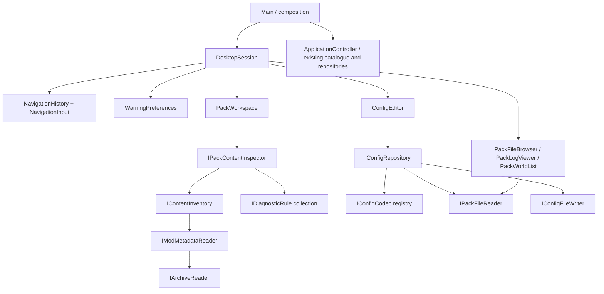

# Foundation architecture

## Ownership and flow

`ApplicationController` retains the catalogue, library and managed-repository application boundary and `CatalogueClient`. Pack content inspection, navigation, preferences and config editing have separate feature models composed by `DesktopSession`; they do not depend on `ApplicationController`. QML pages receive the controller through an explicit required `app` property. Provider HTTP work is asynchronous through `QNetworkAccessManager`. Search and detail generations reject stale responses. Git processes and installation discovery run on QtConcurrent workers. Repository mutations are serialized by the controller's repository-busy state.

`Project` retains provider IDs and source IDs. `mergeProjects` accepts only explicit `provider:id -> shared identity` mappings. If present, load mappings from `project-identities.json` in `QStandardPaths::AppConfigLocation`; example:

```json
{"modrinth:verified-id":"shared-project", "curseforge:12345":"shared-project"}
```

These mappings require review; filenames, slugs, titles and shared source repositories alone do not prove project equivalence. Modrinth wins presentation fields. `mergeReleases` groups exact SHA-1 references only when Minecraft and loader sets match, preserves both provider IDs, and sorts by publication time. Same-label different-file releases remain distinct.

`decodedImageFingerprint` hashes decoded RGBA pixels and dimensions, handling different lossless image containers. Resizing, lossy recompression, cropping, and integration of both galleries need a separate visual comparison service. The current UI's gallery is from Modrinth and deduplicates repeated URLs.

## Local storage

App identity and settings use stable `ModpackStudio` identifiers; the owner-selected display name is Conflux. Managed repositories live below `QStandardPaths::AppLocalDataLocation/packs`. External launcher mods, worlds, logs and metadata are inspected without modification. The owner-authorized exception is an explicit visual-editor Save for an identified supported config, through the dedicated config writer. No other launcher content is imported or rewritten. Modrinth SQLite opens read-only and queries public profile columns only. Current Modrinth instances join their applied content set for game/loader metadata, with legacy-schema and folder fallbacks. CurseForge folders use `minecraftinstance.json`. Metadata absent from Modrinth profiles is shown as unknown; this does not infer a loader or game version. LibraryRow uses fixed thumbnail, source and action columns around one flexible, elided title/detail column. Both managed packs and launcher installations use the same component. Repeated thumbnails reflect the launcher's actual recorded icon, not a guessed replacement.

`pack.json` schema 1 contains a UUID, display name, Minecraft version, loader, unresolved loader version, and exact mod release references. References retain hashes, provider IDs, compatibility metadata and required dependencies. New optional fields retain structured dependency version constraints, expected file sizes and a managed `installPath`. Existing reference-only packs remain readable. `QSaveFile` writes manifests atomically. Pack creation uses exclusive mkdir and sanitized names, including Windows device-name avoidance. A collision is an error. A failed Git initialization may leave the newly created folder for inspection; no recursive cleanup occurs.

Git runs through argument arrays with interactive prompts disabled and timeouts. Save stages only `pack.json` and the pack's `.gitignore` and refuses a commit when other files have already been staged outside the app. GitHub authentication, remote operations, credential storage and conflict resolution are intentionally future boundaries.

## Integration boundaries

Modrinth API v2 requests identify the app. CurseForge requests use an in-memory approved key, with no persistent API catalogue cache. Rate-limit and HTTP errors remain visible; a partial merged result reports unavailable providers. This does not resolve CurseForge API licensing/approval questions.

`modrinthRelease` is the shared parser for primary mod JAR files, required/optional/incompatible dependency records and exact version IDs. ModInstaller resolves required dependencies transitively, handles cycles, prefers stable compatible releases, preserves existing exact pins and rejects conflicts. Optional dependencies are not added automatically. Existing Modrinth pins are revalidated alongside the new root; existing CurseForge references are retained but not resolved or downloaded while that integration awaits approval.

Downloads stream into temporary staging with size and SHA-512/SHA-1 verification. Already installed files are checked on a worker and reused. The user can cancel until the short final application step. PackRepository::applyInstallation checks that the manifest has not changed externally, copies verified files with QSaveFile, and saves the new manifest only after copies succeed. Copy/manifest-write failures roll back newly created files. Installed paths are `mods/<sha1>.jar`; binaries remain ignored by Git. Superseded or explicitly removed managed files are deleted only if their bytes still match the tracked hash. Edited or manual files are retained, with warnings when stale edited files need review. Symlink/junction mods folders are rejected for installation and left untouched on removal. This is an application-level transaction, not a guarantee of crash-atomic changes across multiple filesystem files.

ModInstaller and repository jobs share a UI busy guard. Network work is asynchronous; final file/manifest operations use QtConcurrent. Search/detail requests can continue during downloads, while pack mutations wait. Failed downloads, unavailable dependencies, cancellation, and manifest races preserve the previous recorded pack. A successful mod installation still requires exact loader resolution, Minecraft authentication/installation and launch support before the pack can run. Those, account OAuth, import/export and CurseForge downloads are future work.

## SOLID feature boundaries

The owner requires rigorous SOLID and clear separation for every addition. Keep policies out of QML, file formats out of presentation models, and filesystem details out of domain workflows. Small files alone are not proof of a single responsibility.



| Build target | Responsibility and permitted dependencies |
| --- | --- |
| `pack_storage` | Read/list and config-write ports plus the native filesystem adapter. Qt Core only. |
| `conflux_content` | Archive/identity/icon adapters, indexed config ownership, inventory and independently injected diagnostic rules. Depends on storage, Qt Gui and miniz; no QML. |
| `conflux_config` | JSON/TOML/properties codecs and a repository coordinating parse/validate/read/write. Depends on storage; no views or catalogue. |
| `conflux_desktop` | Focused QObject presentation models and DesktopSession composition. Depends on content/config and Qt Concurrent; no provider APIs or repository mutations. |
| `conflux_style` | Shared JSON theme palette. Views consume semantic roles, including SVG icon tint. |
| `pack_foundation` | Existing provider clients, merge domain, launcher discovery, dependency installer and managed Git repository services. |
| `modpack-studio` | Composition entry point and QML view assembly. Wires existing pack context to independent feature models. |

`IPackFileReader` deliberately has no write method. Files, logs and worlds receive that read-only port. Only the config repository receives `IConfigFileWriter`. Formats implement `IConfigCodec`; adding a format changes registry composition, not ConfigEditor or a view. Rules implement `IDiagnosticRule`; the inspector accepts an inventory and rule collection and never switches on rule types. WarningPreferences uses `IWarningPreferenceStore` and filters presentation by category without weakening validation. Archive and metadata readers have replaceable interfaces. Dependencies are constructor-injected and owned explicitly; there are no feature service locators.

`PackPage` composes focused panels under `qml/pack`; only the active panel is instantiated. Settings composes Appearance, Warnings and Connections from `qml/settings`. Shared rounded controls live in `qml/components`. No view writes files or parses TOML/properties/JSON documents. `ConfigField` presents typed values; codec/repository validation remains authoritative. A `DesktopSession` change must only concern wiring, context propagation or lifecycle. It must not acquire format handling, filesystem policy or warning rules.

## Identity, icons and diagnostics

`ContentInventory` reads known metadata and attaches icon data from bounded archive entries. `ModMetadataReader` understands Fabric/Quilt identity and basic Forge-family TOML identity, and retains universal loader declarations. `ZipArchiveReader` extracts to memory; `rasterIcon` bounds image dimensions and reduces artwork to a small PNG. Resource/shader packs use pack.png when present. Unknown content always has a theme-aware category icon. ConfigAssociation builds a normalized ownership index once per scan; unambiguous filename/directory matches reuse the related mod ID/title/icon. A match is labeled and is not a mod-provided ownership declaration. Ambiguity never silently chooses a mod.

Duplicate IDs, loader/bridge checks, managed pin checks, orphan suggestions and scan coverage are independent rules. Issues have category/message/path fields; the legacy string summary is an adapter for headless callers. Warning visibility is stored separately from the diagnostic result. Scan suggestions never delete configs. Full dependency constraints, nested mod inventories and runtime compatibility remain unfinished.

## Navigation and config editing

NavigationHistory stores page, pack, section, folder, selected log and selected config, with a bounded back/forward stack. NavigationInput only translates mouse Back/Forward presses; toolbar and Alt+Left/Right call the same history. Unsaved edits block navigation and window closing, and produce Save/Discard/Cancel. A failed save retains edits and the pending route. Navigation state is separate from visual selection and supports returning across packs. Worker generations discard stale results for inventory, browsing, logs, worlds and config loads.

ConfigEditor owns a loaded document and draft changes, with typed values available when delegates are recreated after search/filtering. ConfigRepository chooses a codec by extension, validates before writing, and depends on separate read/write ports. JSON preserves numeric values including signed 64-bit integers and serializes the document. TOML uses pinned toml++ parse positions and patches only supported values; comments, CRLF, Unicode keys and unsupported values remain intact. Properties patches supported assignments and preserves unrelated text; duplicate/continued/unsupported assignments are not editable. Collections with internal comment/hash content, complex values and unsafe numeric list precision are omitted rather than silently converted. Explicit TOML range/choice comments become constraints; arbitrary runtime mod schemas are not invented.

NativePackFileStore limits editor documents to 2 MiB, validates config/defaultconfigs paths and rejects linked/escaping paths. Save compares current bytes against the loaded snapshot, writes a unique backup beneath application-local config-backups, rechecks the source, and uses QSaveFile atomic replacement without direct-write fallback. These are optimistic checks, not a filesystem-wide lock against every possible external writer. Backups are outside pack repositories and currently have no automatic retention policy. Unsupported/unknown-owner configs stay inspectable. Editing does not live-reload a running game. Git save still stages the pack manifest/.gitignore; config inclusion is explicitly tracked in BACKLOG.md.

Files browsing is bounded per directory. Logs read plain text tails up to 2 MiB without execution or rich-text interpretation. Worlds list saved-world folders and bounded icons, without parsing or writing level.dat. No automatic config save, world mutation or log upload exists.

## Verification and development

Use `.clang-format` for owned C++ sources; preserve vendored source bytes and licenses. Tests cover actual domain behavior, injected navigation/preferences, config value round trips, lossless TOML/properties edits, conflicts/backups and read-only boundaries. `DesktopSmokeTest` isolates runtime verification from the application entry point. The packaged smoke creates temporary config/log/world fixtures, edits only the temporary config, and captures every section; actual launcher packs are scanned without writes. Always deploy and reopen Conflux after the final verified change. Follow-up work and acceptance criteria belong in [BACKLOG.md](BACKLOG.md).
