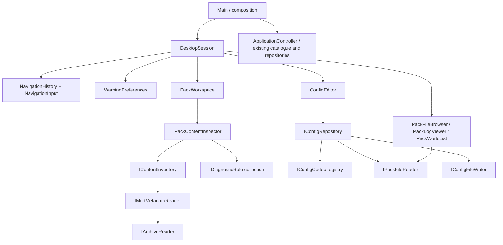

# Foundation architecture

## Ownership and flow

`ApplicationController` retains the catalogue, library and managed-repository application boundary and `CatalogueClient`. Pack content inspection, navigation, preferences and config editing have separate feature models composed by `DesktopSession`; they do not depend on `ApplicationController`. QML pages receive the controller through an explicit required `app` property. Provider HTTP work is asynchronous through `QNetworkAccessManager`. Search and detail generations reject stale responses. Git processes and installation discovery run on QtConcurrent workers. Repository mutations are serialized by the controller's repository-busy state.

`Project` retains provider IDs and source IDs. `mergeProjects` accepts only explicit `provider:id -> shared identity` mappings. If present, load mappings from `project-identities.json` in `QStandardPaths::AppConfigLocation`; example:

```json
{"modrinth:verified-id":"shared-project", "curseforge:12345":"shared-project"}
```

These mappings require review; filenames, slugs, titles and shared source repositories alone do not prove project equivalence. Modrinth wins presentation fields. `mergeReleases` groups exact SHA-1 references only when Minecraft and loader sets match, preserves both provider IDs, and sorts by publication time. Same-label different-file releases remain distinct in the domain. groupReleaseVariants gives the UI one version-label group, retains every variant and puts Modrinth variants first without reversing publication order. isNewerRelease rejects older publication dates, changed project IDs and lower comparable numeric version prefixes.

`decodedImageFingerprint` hashes decoded RGBA pixels and dimensions, handling different lossless image containers. GalleryImages retrieves at most 40 HTTPS images with four concurrent requests, 12-second transfer timeouts, an 8 MiB encoded limit and 4096px dimension limits. It compares decoded pixels and preserves input order, so equal images retain the Modrinth entry. Resized, lossy-recompressed or cropped images remain distinct. Failed image loads are reported without inventing gallery content.

## Local storage

App identity and settings use stable `ModpackStudio` identifiers; the owner-selected display name is Conflux. Managed repositories live below `QStandardPaths::AppLocalDataLocation/packs`. Discovery itself, launcher metadata, world save data and logs remain read-only. Explicit Data Pack installs may add a verified ZIP to the chosen world datapacks directory without changing level.dat. Owner-authorized Content actions can explicitly import/toggle/remove/update JAR/ZIP files through the dedicated content write port; visual-editor Save separately writes identified supported configs. No launcher database or manifest is rewritten by these actions. Modrinth SQLite opens read-only and queries public profile columns only. Current Modrinth instances join their applied content set for game/loader metadata and retain a verified instance ID for launch handoff, with legacy-schema and folder fallbacks. CurseForge folders use `minecraftinstance.json`. Metadata absent from Modrinth profiles is shown as unknown; this does not infer a loader or game version. LibraryRow uses fixed thumbnail, source and action columns around one flexible, elided title/detail column. Both managed packs and launcher installations use the same component. Repeated thumbnails reflect the launcher's actual recorded icon, not a guessed replacement.

`pack.json` schema 1 contains a UUID, display name, Minecraft version, loader, unresolved loader version, and exact mod release references. References retain hashes, provider IDs, compatibility metadata and required dependencies. New optional fields retain structured dependency version constraints, expected file sizes and a managed `installPath`. Existing reference-only packs remain readable. `QSaveFile` writes manifests atomically. Pack creation uses exclusive mkdir and sanitized names, including Windows device-name avoidance. A collision is an error. A failed Git initialization may leave the newly created folder for inspection; no recursive cleanup occurs.

Git runs through argument arrays with interactive prompts disabled and timeouts. Save stages only `pack.json` and the pack's `.gitignore` and refuses a commit when other files have already been staged outside the app. GitHub authentication, remote operations, credential storage and conflict resolution are intentionally future boundaries.

## Integration boundaries

Modrinth API v2 requests identify the app. CurseForge requests use an in-memory approved key, with no persistent API catalogue cache. Rate-limit and HTTP errors remain visible; a partial merged result reports unavailable providers. This does not resolve CurseForge API licensing/approval questions.

`modrinthRelease` is the shared parser for primary mod JAR files, required/optional/incompatible dependency records and exact version IDs. ModInstaller resolves required dependencies transitively, handles cycles, prefers stable compatible releases, preserves existing exact pins and rejects conflicts. Optional dependencies are not added automatically. Existing Modrinth pins are revalidated alongside the new root; existing CurseForge references are retained but not resolved or downloaded while that integration awaits approval.

Downloads stream into temporary staging with size and SHA-512/SHA-1 verification. Already installed files are checked on a worker and reused. The user can cancel until the short final application step. PackRepository::applyInstallation checks that the manifest has not changed externally, copies verified files with QSaveFile, and saves the new manifest only after copies succeed. Copy/manifest-write failures roll back newly created files. Installed paths are `mods/<sha1>.jar`; binaries remain ignored by Git. Superseded or explicitly removed managed files are deleted only if their bytes still match the tracked hash. Edited or manual files are retained, with warnings when stale edited files need review. Symlink/junction mods folders are rejected for installation and left untouched on removal. This is an application-level transaction, not a guarantee of crash-atomic changes across multiple filesystem files.

ModInstaller and repository jobs share a UI busy guard. Network work is asynchronous; final file/manifest operations use QtConcurrent. Search/detail requests can continue during downloads, while pack mutations wait. Failed downloads, unavailable dependencies, cancellation, and manifest races preserve the previous recorded pack. A successful mod installation still requires exact loader resolution, Minecraft authentication/installation and launch support before the pack can run. Independent launch, account OAuth, standard pack import/export and CurseForge downloads are future work. Existing Modrinth installations use the separate supported launch-link adapter.

## SOLID feature boundaries

The owner requires rigorous SOLID and clear separation for every addition. Keep policies out of QML, file formats out of presentation models, and filesystem details out of domain workflows. Small files alone are not proof of a single responsibility.



| Build target | Responsibility and permitted dependencies |
| --- | --- |
| `pack_storage` | Read/list and config-write ports plus the native filesystem adapter. Qt Core only. |
| `conflux_content` | Archive/identity/icon adapters, indexed config ownership, inventory and independently injected diagnostic rules. Depends on storage, Qt Gui and miniz; no QML. |
| `conflux_config` | JSON/TOML/properties codecs and a repository coordinating parse/validate/read/write. Depends on storage; no views or catalogue. |
| `conflux_desktop` | Focused QObject presentation models and DesktopSession composition. Depends on content/config and Qt Concurrent; no provider APIs or repository mutations. |
| `conflux_style` | Shared JSON theme palette. Views consume semantic roles, including SVG icon tint. |
| `pack_foundation` | Existing provider clients, merge domain, launcher discovery, dependency installer and managed Git repository services. |
| `modpack-studio` | Composition entry point and QML view assembly. Wires existing pack context to independent feature models. |

`IPackFileReader` deliberately has no write method. Files, logs and worlds receive that read-only port. Only the config repository receives `IConfigFileWriter`. Formats implement `IConfigCodec`; adding a format changes registry composition, not ConfigEditor or a view. Rules implement `IDiagnosticRule`; the inspector accepts an inventory and rule collection and never switches on rule types. WarningPreferences uses `IWarningPreferenceStore` and filters presentation by category without weakening validation. Archive and metadata readers have replaceable interfaces. Dependencies are constructor-injected and owned explicitly; there are no feature service locators.

`PackPage` composes focused panels under `qml/pack`; only the active panel is instantiated. Settings composes Appearance, Warnings and Connections from `qml/settings`. Shared rounded controls live in `qml/components`. No view writes files or parses TOML/properties/JSON documents. `ConfigField` presents typed values; codec/repository validation remains authoritative. A `DesktopSession` change must only concern wiring, context propagation or lifecycle. It must not acquire format handling, filesystem policy or warning rules.

`ActionButton` owns primary/neutral/subtle action styling, persistent `selected` presentation and input feedback. Selection is supplied by each feature's state; the button does not own routing or filter rules. `NavigationButton` extends it only with sidebar alignment and an active marker; `SectionTabs` composes compact buttons. Search, selects and toggles share the same semantic theme tokens. All palettes retain fourteen tokens across four JSON groups. `Theme` defaults to embedded OLED, retains the original grey palette, copies editable examples without overwriting them, and migrates the old built-in default once using `appearance/oledDefaultApplied`. Subsequent selections and custom themes remain persistent. Presentation changes do not add filesystem, navigation or config policy to views.

## Identity, icons and diagnostics

`ContentInventory` reads known metadata and attaches icon data from bounded archive entries. `ModMetadataReader` understands Fabric/Quilt identity and basic Forge-family TOML identity, and retains universal loader declarations. `ZipArchiveReader` extracts to memory; `rasterIcon` bounds image dimensions and reduces artwork to a small PNG. Resource/shader packs use pack.png when present. Unknown content always has a theme-aware category icon. ConfigAssociation builds a normalized ownership index once per scan; unambiguous filename/directory matches reuse the related mod ID/title/icon. A match is labeled and is not a mod-provided ownership declaration. Ambiguity never silently chooses a mod.

Duplicate IDs, loader/bridge checks, managed pin checks, orphan suggestions and scan coverage are independent rules. Issues have category/message/path fields; the legacy string summary is an adapter for headless callers. Warning visibility is stored separately from the diagnostic result. Scan suggestions never delete configs. Full dependency constraints, nested mod inventories and runtime compatibility remain unfinished.

## Navigation and config editing

NavigationHistory stores page, pack, section, folder, selected log and selected config, with a bounded back/forward stack. NavigationInput only translates mouse Back/Forward presses; toolbar and Alt+Left/Right call the same history. Unsaved edits block navigation and window closing, and produce Save/Discard/Cancel. A failed save retains edits and the pending route. Navigation state is separate from visual selection and supports returning across packs. Worker generations discard stale results for inventory, browsing, logs, worlds and config loads.

ConfigEditor owns a loaded document and draft changes, with typed values available when delegates are recreated after search/filtering. ConfigRepository chooses a codec by extension, validates before writing, and depends on separate read/write ports. JSON preserves numeric values including signed 64-bit integers and serializes the document. TOML uses pinned toml++ parse positions and patches only supported values; comments, CRLF, Unicode keys and unsupported values remain intact. Properties patches supported assignments and preserves unrelated text; duplicate/continued/unsupported assignments are not editable. Collections with internal comment/hash content, complex values and unsafe numeric list precision are omitted rather than silently converted. Explicit TOML range/choice comments become constraints; arbitrary runtime mod schemas are not invented.

NativePackFileStore limits editor documents to 2 MiB, validates config/defaultconfigs paths and rejects linked/escaping paths. Save compares current bytes against the loaded snapshot, writes a unique backup beneath application-local config-backups, rechecks the source, and uses QSaveFile atomic replacement without direct-write fallback. These are optimistic checks, not a filesystem-wide lock against every possible external writer. Backups are outside pack repositories and currently have no automatic retention policy. Unsupported/unknown-owner configs stay inspectable. Editing does not live-reload a running game. Git save still stages the pack manifest/.gitignore; config inclusion is explicitly tracked in BACKLOG.md.

Files browsing is bounded per directory. Logs read plain text tails up to 2 MiB without execution or rich-text interpretation. Worlds list saved-world folders and bounded icons, without parsing or writing level.dat. No automatic config save, world mutation or log upload exists.

## Verification and development

Use `.clang-format` for owned C++ sources; preserve vendored source bytes and licenses. Tests cover actual domain behavior, injected navigation/preferences, config value round trips, lossless TOML/properties edits, conflicts/backups and read-only boundaries. `DesktopSmokeTest` isolates runtime verification from the application entry point. The packaged smoke creates temporary config/log/world fixtures, edits only the temporary config, and captures every section; actual launcher packs are scanned without writes. Always deploy and reopen Conflux after the final verified change. Follow-up work and acceptance criteria belong in [BACKLOG.md](BACKLOG.md).


## Content interactions, updates and filesystem events

ContentActions owns filtering, sorting, selection, frozen-version presentation and asynchronous operation state. It receives IContentFileStore, IContentCatalogue, IContentInstaller and IContentPreferences; it never opens files or performs HTTP itself. NativeContentStore hashes snapshots, restricts writes to immediate content-directory files, rejects linked/escaping paths, backs up originals, rechecks hashes, and rolls back prior file operations if a later step or managed-manifest update fails. These are optimistic checks rather than a lock against every external writer. Folder-based packs are not file mutations.

ContentCatalogue batches Modrinth hash identification, compatible stable update lookup, project metadata and team/author retrieval. No name matching establishes identity. Environment and recognized SPDX license data support filters; unknown data stays unknown. Update comparisons do not turn an older stable release into an automatic downgrade. Versions load on demand. SettingsContentPreferences persists explicit version freezes; file-hash preferences migrate to a verified provider identity without overriding a later explicit unfreeze.

ContentInstaller reuses ModInstaller.startBatch for one dependency graph and verified install transaction. Managed packs with only tracked files use the established repository path. Existing launcher packs and managed packs with imported files first build an isolated temporary pack, using hard links where possible and copies otherwise. Unknown local files participate in the duplicate-mod check. Downloads never overwrite hard-linked input bytes. NativeContentStore.applyStaged rechecks all original mod hashes and inventory membership, maps files back to their existing names when unchanged, preserves disabled state and applies verified replacements with backups. Managed imported projects become exact pins. External launcher metadata remains untouched. Frozen/disabled dependency conflicts stay visible rather than silently enabling or upgrading them.

PackChangeMonitor watches the pack and bounded content paths with QFileSystemWatcher and a 450ms debounce. It invalidates local scans after changes; it does not continuously poll provider APIs. Local metadata appears immediately while async hashes/updates load. Refresh remains available for provider changes and changes not covered by a watcher. Composition serializes mutations with the existing controller busy state. The Views contain only presentation/callback wiring. ContentPanel, ContentFilter, SelectionBox and VersionPicker are separate controls. Warning details open from a badge beside the pack name.

## Native showcases and launch handoff

ProjectShowcase receives an installed-file identity port and a catalogue port. NativeInstalledModIdentity verifies SHA-1 bytes, managed pin hashes, or CurseForge installed-file metadata; the catalogue's hash endpoint identifies Modrinth projects. CatalogueShowcaseSource expands only unambiguous reviewed provider mappings, preserves Modrinth presentation priority and composes bounded gallery deduplication. Native API Markdown/HTML descriptions are converted to selectable Qt rich text with inline images, author colors and non-HTTPS links removed; themed links open through the web boundary; galleries and grouped variants have independent tabs. Stale responses cannot replace a newer route. Public comments are not available through the supported API contracts.

WorldLaunch receives provider adapters, a URL opener and a read-only pack-file reader. ModrinthWorldLaunchAdapter constructs percent-encoded modrinth://launch/instance/{id} links, optionally with singleplayer_world. World launch requires a verified ID, a known supported Minecraft version, a current contained saves directory and readable level.dat. DesktopLaunchUrlOpener uses the registered launcher; Conflux never reads its credentials. A successful handoff reports that the request was sent, not that Minecraft successfully started. CurseForge and independent Conflux launch remain unavailable until a supported runtime/account adapter is implemented. This follows [Modrinth's shortcut implementation](https://github.com/modrinth/code/blob/main/apps/app/src/api/shortcuts/mod.rs).

## Settings and verification additions

SettingsPage uses a fixed-width vertical category index and a separate responsive content pane. Settings and showcase routes participate in the same guarded history. UI pointer dispatch is verified in a test-only executable rather than linking Qt Test into the application. Tests additionally cover stale showcases, exact world-link encoding and path rejection, file backups/conflicts, managed import pins, freeze persistence, selection/filter logic, debounced events and multi-root updates. Packaged verification uses temporary writes and only inspects real launcher installations.

## Description, navigation and config correction

DescriptionRenderer normalizes raw HTML inside Markdown before parsing to avoid a Qt mixed-image/HTML text-loss bug, then parses provider Markdown/HTML and emits a controlled native rich-text subset. It preserves text, headings, emphasis and HTTPS links without serializing provider font colors, frame/table CSS, inline images or empty image-only blocks. This prevents inherited black text and empty web layouts on OLED. The QML theme supplies foreground/link colors.

NavigationHistory replaces the current route for section, folder, log, config or Settings/showcase-tab changes within the same page identity. Page identity includes the pack and, for showcases, the installed file or catalogue project. Back/Forward traverses pages and restores each page's most recent local selection. The same unsaved-config guard applies to replacements.

Forge-family identity uses the existing pinned toml++ parser and reads only the actual mods array declaration, never a dependency's modId. Genuine duplicate issues group all enabled file paths under one ID.

ConfigLibrary owns config availability/presentation and explicit owner associations through IConfigOwnershipStore; SettingsConfigOwnershipStore persists local per-pack/per-file choices. It derives supported extensions from the codec registry. Missing/stale associations cannot enable editing. DesktopSession composes this model and resolves editor targets from it after workspace scans. The view defaults to editable files; Needs review exposes Identify mod and format limitations. Existing codec-backed forms, backup/conflict checks and explicit Save remain authoritative.

Catalogue invokes registered Java IConfigScreenFactory screens; Configured obtains loaded ModConfigSpec values, defaults, validation and restart metadata at runtime. These are not executable from a C++ launcher without a game-side bridge. Conflux supplies offline typed controls from supported file values and explicit TOML metadata, and does not invent missing defaults/enums/runtime constraints. Research: [Catalogue](https://github.com/MrCrayfish/Catalogue/blob/c556f997d5539c77fb3371eeccf755ca8a00f321/neoforge/src/main/java/com/mrcrayfish/catalogue/client/NeoForgeModData.java), [Configured](https://github.com/MrCrayfish/Configured/blob/9f78baf593ca1d90ffec7c2d9d8a4a2d027d15e4/neoforge/src/main/java/com/mrcrayfish/configured/impl/neoforge/NeoForgeConfigProvider.java).

UI glyphs use the Lucide SVG subset pinned at c29c276f16590cf017126671535ad8c792be64d8; third_party/LICENSE.lucide retains its license. Shared ContentIcon crops artwork to fill its rounded clip. Artwork stays separate from UI glyphs.

## Instance-scoped Explore content

BrowseInstalls receives IContentCatalogue and consumes indexed content supplied by DesktopSession. Exact requested/context path matching and lookup generations prevent stale installs. Installed state uses provider IDs/hashes; disabled files remain installed. Data Packs are instance-scoped, including compatible mod-form variants. World selection is no longer part of browsing or installation.

BrowseCatalogue owns typed query filters, provider cursors, deduplication, cached pages and per-instance/content-type scroll state behind ICatalogueSearch and IContentVisibility. It merges sorted provider streams in bounded batches, preserves provider rank when relevance scores cannot be compared, hydrates reviewed CurseForge identities from Modrinth before publishing, and retains distinct download counts. Next/Previous use generated pages without refetching when returning from showcases. Each generated page is bounded to 24 source reads; heavily hidden result sets can yield a partial page with an explicit notice. Provider/API failures are visible. CatalogueClient translates typed multi-version/loader/tag groups into native provider requests and fetches version/category taxonomy. Provider-scoped tags never imply guessed cross-platform category equivalence. Followers have no native CurseForge equivalent; that source uses popularity with a visible notice.

ContentVisibility stores explicit project IDs, exact hashes and per-instance fallback paths through IBrowseSettingsStore; hiding changes presentation, never enabled state or installed files. BrowsePreferences independently owns the persisted Connector search option. ReviewedProjectIdentities is the bounded file adapter for reviewed source mappings, shared by browsing and showcases; ambiguous groups are rejected.

ContentInstaller dispatches mods to the dependency transaction and ZIP assets to AssetInstaller. Size/hashes/ZIP structure, staging, backups, collisions and optimistic manifest checks remain. Managed ZIP references are recorded in assets and download directories stay Git-ignored. ZIP packs with required dependencies remain visibly blocked until cross-type planning is available.

Data Pack ZIPs install into instance datapacks/, never saves. ZIP-only data packs require a global data-pack loading mod to apply across worlds; no world/NBT rewriting or running-world synchronization is claimed. Compatible native JAR variants are preferred and use the existing mod/dependency installer. Enabled verified Connector metadata admits Fabric alongside Forge/NeoForge through ContentCompatibility; bridge transactions always use isolated staging and recheck the original inventory before application. Primary loader metadata stays unchanged, and runtime compatibility is not inferred from bridge presence.

## Shared branding and rounded presentation

ContentTypes supplies display labels while canonical loader/type IDs remain lower case. Branding is a Conflux.Style singleton backed by themes/brands.json; BrandBadge shares loader/provider imagery, identity colors and rounded geometry. Official Fabric/NeoForged artwork and Simple Icons provider glyphs retain attribution/license notices. Forge/Quilt use Lucide compatibility symbols. Identity colors do not add feature-specific theme color tokens.

ProjectCard presents artwork, title/author, summary, category/loader badges, Install/Installed state and independent provider statistics. It contains presentation callbacks only. ContentIcon supports cropped squares and fitted gallery images with rounded Canvas clipping on software and normal Qt rendering; author avatars use the same component. Shared controls/menus remain rounded.

CompatibilityBadges is the shared version/loader pair: neutral Minecraft-version pill directly beside the branded loader pill. Library separates this intrinsic-width group from the flexible mod count. Pack headers, browse filters/cards and release rows reuse it. List/Grid views set StopAtBounds; BoundedScrollView applies the same policy to Qt Quick Controls' auto-created Flickable so settings, descriptions, logs and menus cannot rebound past their content.

BrowseFilterPreferences implements IBrowseFilterPreferences over IBrowseSettingsStore. It persists only version/loader choices, version-lock state and whether loaders still follow instance/Connector defaults, partitioned by hashed instance identity and content type. BrowseCatalogue retains provider cursors and pages in memory independently for each such view. Restoring a view while instance metadata is pending must not erase its compatibility or page. Version relocking affects versions only; loaders remain editable. Saved manual loader selections override later Connector-default changes. PaginationBar groups source selection with page controls and wraps its two control groups at narrow widths; the instance selector aligns with the fixed-width filter panel.

The shell top bar owns route titles and the Explore instance selector; DiscoverPage owns the content toolbar/results and filters, with no duplicate title/context block. New-pack creation remains in the sidebar and Ctrl+N. BrowseFilters uses a virtualized, bounded multi-select list for all API-provided game versions when unlocked. RoundedToolTip centralizes tooltip background/text/theme and replaces all attached default tooltips.

### Appearance authoring and layout preferences

Theme is a palette/selection/draft model; ThemePalette owns the four-group/fourteen-role schema and JSON codec. IThemeStore isolates file/selection persistence, with NativeThemeStore handling bounded contained reads, safe generated custom filenames, QSaveFile writes and the existing OLED migration. Color drafts preview immediately across the UI; Save theme writes a custom JSON without modifying presets. Invalid colors/files keep the last valid palette; discard restores the loaded palette.

Appearance owns validated size descriptors and values behind IAppearanceStore; NativeAppearanceStore persists them separately from theme documents. Overall UI scale transforms the logical shell viewport and popup overlay together. Compact sidebar layout and constrained filter widths protect small viewports. Content scale, artwork size/insets/gaps, filter scale/width/section spacing and version-list height are independent preferences. AppearanceSettings pins an AppearancePreview above its scrollable controls; that preview reuses ProjectCard and BrowseFilters with explicitly labeled example data, without network/file actions. Smoke runs isolate both style models under their temporary storage directory.

ProjectCard uses a compact single-line summary, equal artwork insets, right-side actions and a bottom-aligned bounded horizontal badge row. All metadata remains available by horizontal scrolling when it cannot fit. Badge order is provider icons, the intersection of supported/selected loaders (empty filter means all), Minecraft version, environment/category tags. Native installed-content tables also keep menus at the far right. Loader/provider brand colors remain centralized identity metadata; the fourteen UI roles cover configurable theme colors. Built-in palettes use candy-red #FF005E accent.

ReleaseFilters is a pure showcase selection model: OR within channel/game-version/loader choices, AND across groups and source. Mod showcases fetch all releases; defaults select actual instance compatibility, independently of installation validation. Group filtering preserves exact variant maps/hashes and Modrinth ordering. Shared ChoiceFilter bounds searchable multi-selection; PopupButton uses modal outside-press dismissal so a second click closes without reopening. ActiveBrowseFilters summarizes discovery choices; only instance-controlled game versions display a lock. Static scan/compatibility paragraphs are omitted from browsing surfaces while failures and actionable diagnostics stay visible.

FocusPopup and FocusDialog centralize modal input blocking, keyboard focus and overlay stacking for all in-app menus, selectors, warnings and dialogs; native file/color dialogs retain native focus. Content tables omit an outer stroke. Contiguous row hover/selection backgrounds fill each rectangular cell; a single outer table corner mask rounds the complete frame, including partially visible rows. The table disables nested viewport corner masks and omits the final row divider. ActionButton gates hover, pressed and keyboard-focus effects on enabled state, including a button that becomes unavailable under the pointer.


### Native source content and gallery viewing

DescriptionRenderer parses provider markup into RenderedDescription: readable HTML plus typed text, image-row and table-cell blocks. Raw HTML fragments in Modrinth Markdown are converted before parsing to avoid Qt dropping text after banner blocks. A small HTML/URL boundary removes scripts, provider colors, event attributes and non-HTTPS media, preserving text structure and source image links. Text blocks inherit the theme; DescriptionView lays out responsive rounded images, selectable text, code, quotes and table cells. The parser owns markup conversion; QML only presents blocks and emits link/image intents. Arbitrary browser CSS, embeds and scripts are not executed. Source document input is limited to 2 MiB and frame traversal to twelve levels.

GalleryView renders verified source images and emits selected indices. GalleryViewer owns only transient image selection, fit-relative zoom and pan; it uses the shared focused modal policy, keyboard arrows/Escape, previous/next, zoom/reset, original-link and Close controls. Native file/provider/installation state is unaffected.

ContentListView and ContentGridView reserve a separate sixteen-pixel scrollbar lane. ContentScrollBar supplies rounded consistent thumbs; ScrollViewportCorners covers viewport corners on both software and native rendering, including partially scrolled hover backgrounds. BoundedScrollView reserves the same lane for forms/descriptions. ProjectCard uses one filled rounded surface, explicit author/title baselines, provider download icons, optional known follower counts and an icon-led relative update date. Installed opacity is a validated persistent Appearance value (25-100%, default50); uninstalled cards remain at full opacity independently of install readiness. The previous unavailableOpacity setting migrates to installedOpacity when no new key is present. The live preview includes an installed example. Card children disable tooltips while retaining accessible names; shared controls retain tooltips elsewhere.

ActionButton hover/down/disabled/focus states change paint only, never size, padding, font metrics or corner geometry. Icon-only actions are circular; FilterChip contains its circular trailing remove action with an inset and paints keyboard focus on the enclosing pill. SearchField owns a contained trailing clear action that emits the same textEdited intent as typing and returns focus to the field. ContentPanel separates filters from a padded/divided action group, orders Hidden/Updates/Update all and anchors Refresh at the far right; groups wrap at narrow widths without forcing the table out of bounds.

ProjectCard aligns installation, statistics and update age to one trailing column, reserving a separate far-right menu rail. ContentStatistic owns consistent sixteen-pixel provider/semantic icons, numeric text and vertical centering; provider counts remain separate.

### Tabbed settings and presentation preferences

Settings keeps the vertical category index with compact icon navigation on small logical viewports, omitting a duplicate page heading. AppearanceSettings owns Interface/Content/Filters/Colors sub-tabs, current-section search, preview visibility and bounded control scrolling. AppearanceField renders validated numeric, toggle and choice descriptors; per-field and per-section reset leave other groups and theme drafts intact. ThemeSettings separates theme selection/draft saving from layout preferences and divides all fourteen existing roles into Surfaces/Text/Actions/Status tabs. Preview uses real shared rows/cards/filter components with labeled example data.

Appearance persists twenty-six presentation values through IAppearanceStore: the existing sizes/opacity plus library/instance row height, scrollbar width, tooltip delay/visibility, persistent live-preview visibility, navigation mode, reduced motion and seven card-metadata toggles. RoundedToolTip owns the shared visibility gate; callers request showWhen rather than overriding visible. Existing button/field/library/switch transitions honor reduced motion. Instance rows retain one rounded outer table frame.

BrowsePreferences validates and persists default sort/page size/provider/installed visibility through IBrowseSettingsStore, separately from Connector selection and per-instance/type compatibility. BrowseCatalogue.setDefaults seeds previously unseen views; visited snapshots and saved version/loader filters take priority. DesktopSession only composes the model updates. Browsing Defaults offers an explicit Apply to current view action; changing defaults alone does not reset the user's active query/page. Invalid persisted defaults fall back without writes during load.

GalleryViewer uses a full-screen backdrop mouse area that accepts only clicks outside both the visible image viewport and toolbar, rejecting presses over either surface so control clicks and drag-to-pan reach their existing handlers. Its100% zoom baseline is galleryFitPercent (60-100%, default83) of the available fit area; zoom controls remain relative to that baseline.

ProjectCard hover uses an ancestor HoverHandler independently of its click MouseArea. Child badge/statistic/button hover cannot clear the filled card highlight.

BrowseCatalogue sends loader constraints only for mod discovery; other content types retain their saved state without applying or displaying those constraints. ProjectCard retains non-mod loader/data-pack metadata independently of hidden loader selections. CatalogueShowcaseSource explicitly requests allVersions from CatalogueClient for complete release filter choices; installer callers retain constrained requests by default. ReleaseFilters includes datapack as a platform alongside real loaders, preserves exact variants, and combines platform choices with OR. ChoiceFilter provides a selected-value/count trigger, separate inline Clear, searchable bounded list, selected count/Clear header and trailing checkmarks.

ContentCatalogue separates stable update queries by destination and platform: mods use actual compatible loader union, resource packs minecraft, data packs datapack and shaders their identified loader set. Hash plus category keys prevent cross-format collisions. Only newer exact-project stable releases with the same archive kind, game version and permitted loader become update candidates; every check resets stale flags. See [Modrinth bulk update API](https://docs.modrinth.com/api/operations/getlatestversionsfromhashes/).

ContentActions uses already indexed updateRelease values for Update all/selected and preserves each contentType. Implicit file-change refresh identifies only new/changed hashes and merges by path/hash; explicit Refresh checks everything. ContentInstaller serializes verified ZIP transactions before one mod dependency batch, advances its own managed asset pins between successful writes and reports changed=true after partial completion so inventory refresh still occurs on a later failure/cancellation. Completed batches remain backed up; this is not an atomic cross-content rollback guarantee. Mod dependency integrity checks remain in place. Bulk enable/disable builds one optimistic NativeContentStore edit transaction. Data Pack selection/import and directory monitoring match the other instance categories.

ContentSelectionBar is an anchored sibling overlay: selecting does not change table/list geometry. Its compact form uses icons and its Share popup copies locally through copyRequested (no remote posting). ContentActivity reserves fixed toolbar space for operation status/cancel, opens focused error details and omits routine success/cancellation paragraphs. ContentActions.notice is reserved for actionable problems while activity/activityText carry transient operation presentation.

ContentLink shares underline-only pointer/keyboard behavior without altering metrics. Instance and discovery names open Description, version labels open Versions, and author links open a dedicated discovery context using exact provider author identifiers. The author context starts with All content and unrestricted compatibility, retains its own pages/scroll/type and preserves the instance install destination. Author navigation is a distinct history entry; tab changes remain within the page. Modrinth authored projects use [user projects](https://docs.modrinth.com/api/operations/getuserprojects/) then the existing typed/paged search. CurseForge uses [authorId filtering](https://docs.curseforge.com/rest-api/#search-mods), behind the approved-key gate. Project results still merge only through reviewed project identities. ReviewedAuthorIdentities reads bounded author-identities.json provider:id -> shared group mappings from AppConfigLocation, rejects ambiguous/conflicting mappings and never matches display names. Missing cross-platform identity mappings do not authorize querying unrelated creators; live CurseForge use still needs an approved key.
